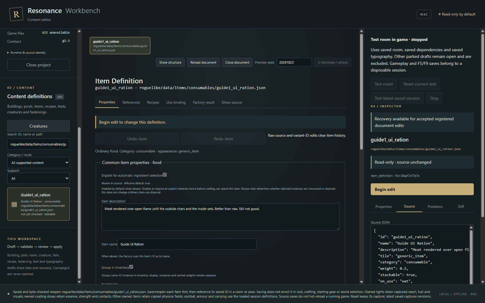

# L02 — Create a usable item and make it reachable

Create a supported food variant, understand the equivalent JSON, and use a physical instance. A definition becoming valid, becoming saved, becoming reachable and becoming consumed are separate events.

## Start independently

The complete ration, workroom and note are supplied under `examples/guide1/data/`; L01 completion is optional. You need the [launcher setup](#learning-path), and for the optional authoring UI, the installed Resonance Workbench package. Keep the executable, bridge and packaged Python together. The source build requirements are in [Workbench internals](#workbench-internals).

Predict: does saving a new food place it in every container? Will a same-ID sibling disappear when you eat one? Can a new `on_use` word implement a new power?

## Author a candidate through Workbench

Use a disposable authoring fixture, never select a personal campaign as test state. GUIDE-1's focused native journey is `Resonance_Wiki_Maintenance/verify_workbench.mjs`; it uses its own data fixture. The old `run-items.mjs` retains obsolete light-item assertions and is not a current acceptance route. For a manual exercise, `practice.py L02 --keep` announces a disposable payload; select that payload root in a separate Workbench session. Do not use it as a development checkout.

1. Search for `cooked_meat`; open **Begin edit**, then **Save as new variant**.
2. Choose a unique ID such as `guide1_your_ration`. Set a meaningful name, weight and nutrition under **Properties**. Keep the admitted food use capability.
3. Inspect **Use binding** and **Factory result**. They explain binding and construction; neither claims ordinary use happened.
4. **Validate draft**, review diagnostics and incoming **References**, then **Review & apply** and **Confirm apply one file**. The “Saved and byte-checked reopen” message establishes publication of that one file into the selected disposable fixture. Some families whose source is variant-only show **Apply variant** instead; that is not this food route.
5. Read the saved JSON. Compare it with the complete [L01 solution](#L01). UI labels are projections of the same fields, not a second content system.



Observed native Workbench in GUIDE-1's disposable payload. The published variant has 180 nutrition and 0.2 kg; the original `cooked_meat` remains byte-identical. This view proves editor publication, while the separate lesson run proves ordinary pickup/use.

For the fixed runnable solution, the ID is `guide1_ration`; use it unchanged with `--draft`. The separate `guide1_your_ration` UI candidate needs its own binding: open the supplied `guide1_workroom` in the retained payload, begin editing, choose its direct ration item special and replace `item_id` with your saved candidate ID, preserving the coordinates. Validate, review and save that room, then **Test room → latest saved**. Pick up and use your uniquely named item at arrival. **Reset capture** repeats the previous immutable capture; it does not include your latest saved edit. This manual candidate is distinct from the fixed automated answer, which always targets `guide1_ration`.

## Give it an appearance route

The supplied room has a direct item record with `item_id: guide1_ration` at the player's arrival. This establishes controlled placement. A pool alternative needs a weighted entry and a room/container that actually binds that pool. A debug spawn establishes construction only. `spawn_zones` and a plausible filename do not enroll an item in a drop route.

```powershell
& $ResonancePython -X utf8 -B Resonance_Wiki_Maintenance/practice.py L02 --output evidence/guide-1/l02
& $ResonancePython -X utf8 -B Resonance_Wiki_Maintenance/practice.py L02 --play
```

For manual play, pick up the ration at arrival with comma/G, choose the ration if a selection prompt opens, then open `I`, select it, and press `E`/Enter. This spends one phase and consumes one physical unit. The automated receipt labels any direct fixture provisioning separately from ordinary acquisition; do not read provisioning as loot discovery.

## Trace identity and rejection

`ItemFactory.create` uses the definition ID to construct an object. `Inventory.contains` uses exact object identity, not merely matching IDs. `ItemSystem.use` first rejects stale ownership and full paralysis, then resolves `_use_eat`. `InventoryScreen.handle_key` performs consumption/time based on the result and `last_use_committed`.

The false return from a reusable committed action means “not consumed”; it does not necessarily mean failure. `consumed_on_use` is also not a universal use-disposal switch: crafting's automatic material choice consults it, while material/tool roles decide what crafting spends. [L04](#L04) separates those decisions.

## Vary, diagnose, make

**Guided variation:** change the ration to 180 nutrition and 0.15 weight, then use a pool as its future acquisition route. Preserve the `eat` capability. Validate the pool only after the referenced item is saved. Compare a new roll with already generated stock.

**Fault:** a valid new item never appears in a container. First establish factory construction, then inspect the container's actual pool IDs, the pool's entries and whether stock already exists. Reopening a generated container does not reroll it. Do not raise a weight until the route exists.

**Independent task:** design a drink variant with a deliberate hydration/weight tradeoff and choose direct room placement or a reusable pool. State which dependency must be saved first, how ordinary use spends time, and which existing objects should remain unchanged.

<details><summary>Hint 1 — Separate definition and appearance</summary><p>A saved file provides a possible object, not a request to place one.</p></details>
<details><summary>Hint 2 — Locate the route</summary><p>Read <code>item_authoring.py</code>, <code>pool_authoring.py</code>, and the actual room's <code>special_tiles</code>. Then inspect <code>ItemFactory.create</code> and <code>ItemSystem._use_drink</code>.</p></details>
<details><summary>Hint 3 — A partial step</summary><p>Save the item, save the pool that references it, then bind the pool in a newly constructed room/container. Use an empty/new fixture, not a personal saved container.</p></details>
<details><summary>Complete solution and rationale</summary><p>The supplied ration JSON plus the workroom's direct record are the full fixed solution. A pool version needs an entry referencing that ID and a container referencing the pool; both references matter. For a drink, clone a currently admitted drink source, preserve its capability/empty-form contract, and change hydration/weight within validation limits. <code>_use_drink</code> exchanges an empty-form drink before changing thirst, so a failed exchange must leave thirst unchanged. A saved owned item may retain captured fields even after definition edits; test a new instance separately.</p></details>

## Lifetime, cleanup and later practice

Running catalogue: restart to read changed defaults. New instance: factory defaults. Loaded instance: saved physical fields. Unbuilt room: current room/dependency rules. Generated room: owned stock. New world: new selection opportunities, still requiring enrollment. This is the same lifetime model as L01, now with an explicit placement edge.

Close the disposable Workbench/game before discarding its announced temporary root. Keep only candidate JSON you intentionally authored; never copy the entire captured payload back. Revisit by diagnosing a missing food without using debug spawn as your final appearance proof. Continue to [L03](#L03), [L04](#L04), or jump directly to [places](#L06).
