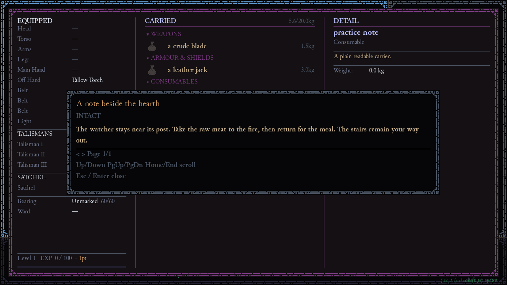

# L08 — Give content a readable appearance

Change a real display role and verify it in the actual text reader. This small visual lesson teaches the same reference chain needed for sprite work: resource → registry/profile → consumer → initialization → rendered evidence.

## Start, predict, run

The fixture supplies the note/carrier, existing project fonts and the full typography profile. It changes only `font_ui_normal` from `Junicode.ttf` to `Junicode-Bold.ttf`; nominal size remains 18. Predict whether this affects unknown-language glyph generation, already initialized screens, or saved campaign data.

```powershell
& $ResonancePython -X utf8 -B Resonance_Wiki_Maintenance/practice.py L08 --output evidence/guide-1/l08
```

The run checks the actual font resource/glyph contract, initializes the production display, acquires/opens the note and captures the real reader. Compare `L08/reading.png` with L03's capture. It does not claim every panel or arbitrary Unicode is covered.

## The complete edit and its owner

Workbench's Typography page edits the fixed profile; select the ordinary-prose role, preview, validate and publish to the disposable payload. The equivalent source is:

<!-- PRACTICE_FILE: policies/typography.json -->

`engine.typography.ROLES` owns thirteen role names, retained nominal sizes and functional glyph requirements. `DisplayConfig.init` initializes fonts/metrics from the profile; screen renderers use those font objects. Changing a resource assignment is not a change to font size or layout. Cached screens need initialization again; saves do not own this profile.



Actual Pygame reader after ordinary carrier pickup and inventory use, with the supplied bold-prose profile. Paragraph wrapping and the page/scroll controls are visible. It is not a mocked typography preview or proof about every screen.

## Apply the same reasoning to a sprite

Inspect a consuming definition's tile/key, then `data/sprites/sprite_map.json` and its sheet entry. Confirm sheet path, native cell width/height, row/column and all users of the key/cell with `rg`. The current art has 16×16 registered cells; display zoom is separate. A standalone PNG outside the registry is not a new game sprite. Use a distinct unused cell or new sheet and register a new key when other users must retain their artwork; a new alias to the same cell does not isolate pixel edits. Update the consuming definition deliberately. Check actual rendering at native and displayed sizes, including tint/full-colour mode when you claim both. [Sprites and atlases](#sprites-and-atlases) gives the full current map.

## Vary, diagnose, make

**Guided variation:** change the ordinary prose role to `Junicode-Italic.ttf` in a copied full profile, retaining `id: game_typography`. Run `L08 --draft authoring/guide1/typography.json`. Inspect readability, line wrapping and footer; a valid glyph contract does not guarantee your preferred style.

**Fault:** reference a missing font or register a sprite under a key no definition uses. Candidate font validation is strict. Runtime `initialize()` falls back to the complete known-default assignment on an invalid saved profile with a `FONT_FALLBACK` warning; it raises if those defaults also fail. The unused sprite key can leave the game unchanged without a parse error. Find the broken edge before editing renderer code.

**Independent task:** improve the distinction between a clue's heading and prose, or give one item a distinct already registered visual. Choose a role/key without unintentionally changing shared users. Acceptance: exact resource reference, actual render, no clipped required instructions, and a stated limit on untested screens.

<details><summary>Hint 1 — Look for the consumer</summary><p>A file's existence is not enough. Find the role/key requested by the screen or item.</p></details>
<details><summary>Hint 2 — Relevant source</summary><p>Read <code>typography.py:ROLES/initialize</code>, <code>DisplayConfig.init</code>, <code>TextReader.render</code>, or <code>rendering/sprite_registry.py</code> for sprites.</p></details>
<details><summary>Hint 3 — Partial step</summary><p>Keep the profile shape and all other roles unchanged. Select an existing project font, then initialize a fresh process.</p></details>
<details><summary>Complete answer and rationale</summary><p>The full bold-prose profile above is the worked solution. The guided answer replaces only that role with Junicode-Italic.ttf. A valid independent heading/prose contrast can keep prose regular and heading bold, provided both resources validate and the actual reader remains legible. Unknown Deep Tongue glyphs use their own generation path, and typography does not alter campaign state. For a sprite, the complete change is resource/registered key plus consuming definition—not just a new image file.</p></details>

## Restart and revisit

Running screens retain initialized metrics; fresh displays use the saved profile. Loaded items/scenes do not cause font migration; new worlds are unnecessary. Rerun to reset, or keep your external candidate. Revisit by explaining why an animation frame can change brightness without spending a paid phase or changing mechanical light reach.
