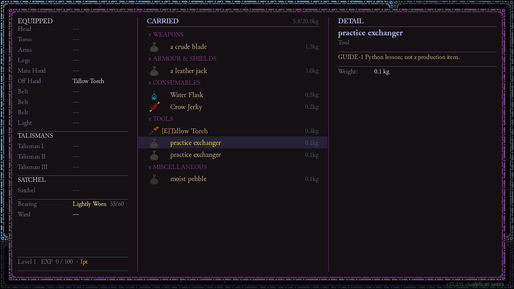

# L10 — Implement a new ability primitive

Build a reusable practice exchanger: recover up to three HP in exchange for 0.1 normalized thirst capacity. This behavior is new Python, not a renamed healing item. It deliberately has no new persistent state: the existing fighter/needs owners already save the changed values.

## Starting fixture and prediction

The distributed `solutions.py`, `installation.patch`, `patch-baseline.json` and fixed launcher supply a complete integration. The patch adds `roguelike/engine/guide1_practice.py` and an explicit installation call at the end of `engine.py`. The launcher checks the baseline and applies those exact bytes only to a newly captured bounded payload. Production `engine.py` remains unchanged. The installed module registers real ItemSystem methods, perk handlers and save validation; it is not an alternate game engine or arbitrary Python service.

Predict: should full HP spend time? Should a reusable success return true? What must be checked before either resource changes?

```powershell
& $ResonancePython -X utf8 -B Resonance_Wiki_Maintenance/practice.py L10 --output evidence/guide-1/l10
```

This scenario uses the **original `Engine.run` event loop** with Pygame events posted only to its own queue and SDL dummy display. It observes injury recovery, thirst cost plus the actual biome tick, one paid phase, retained exact tool/sibling, and full-resource/insufficient-resource/stale-object/malformed-config rejection. It cold-loads the reusable tool. The emitted fingerprints bind the distributed solution and installation patch to this run.

## Step 1 — Define and parse configuration

The existing factory already copies an `on_use` string. It does not need another switch. The new capability is `guide_exchange`; its configuration is definition-owned and looked up in the current session catalogue. Saved tools retain physical fields, while a deliberate later config edit affects use in a new session. The complete input is:

<!-- PRACTICE_FILE: data/items/tools/guide1_exchange.json -->

`parse_exchange` requires exactly version/heal/thirst_cost, rejects booleans as counts, rejects nonfinite values and bounds the cost. A field that parses syntactically but is invalid semantically must refuse before mutation. Workbench's current item adapter does not gain this new capability; this is a manual source lesson.

## Step 2 — Plan the result before applying it

`plan_exchange(fighter, needs, config)` checks life, injury and remaining thirst capacity. Needs uses 0 full → 1 critical, so spending capacity **increases** thirst. It returns an immutable `ExchangeResult` or `None`. Calculating a result first makes rejection atomic: no half-applied heal followed by a failed cost.

`use_exchange` applies the fully checked HP/thirst values once, logs the exact recovery, sets `last_use_committed = True`, and returns `False`. This return preserves the reusable item; inventory still charges one phase because commitment is true. The common `ItemSystem.use` dispatcher already checks exact ownership and full paralysis, so the handler does not invent a weaker parallel check.

## Step 3 — Register at the real seam

`install()` binds `ItemSystem._use_guide_exchange` to the method. Ordinary inventory `E` resolves it through the existing dispatcher. The complete file and actual patch are in [Full code and practice solutions](#practice-solutions). Nothing is left as “wire it into the engine.” The test never substitutes a fake success result for this input path.

To inspect source compatibility without changing production:

```powershell
& $ResonancePython -X utf8 -B Resonance_Wiki_Maintenance/examples/guide1/patch_guard.py check --root .
git apply --check Resonance_Wiki_Maintenance/examples/guide1/installation.patch
```

Use the captured practice route for routine learning. Deliberate production installation/byte-preserving rollback instructions are in the solution reference; no build or reader action applies patches.



Actual captured game frame after app-local `E` input in the original loop. The receipt checks HP, thirst, one paid phase, no consumption and unchanged same-ID sibling; the image alone cannot prove those counters.

## Vary, diagnose, make

**Guided variation:** require a cost of 0.2 for five HP. Change the complete item's `guide_exchange` values, then update the scenario's expected HP/cost. The algorithm does not change; configuration is intentionally separate. The accepted snapshot must include the ordinary needs tick. The full variation is the same item with `heal:5, thirst_cost:0.2`.

**Fault:** return false without setting commitment. HP/thirst can change while no phase is paid. The ordinary input assertion catches it; a direct `plan_exchange` test would miss it. Another fault is mutating thirst before checking injury, which spends resource on rejection.

**Independent task:** choose a different bounded exchange or reusable item action using existing state owners. Decide its rejection conditions and whether success consumes the item. Supply parser, pure result, application, binding, feedback and accepted/rejected input evidence. If it adds a timer/state owner, use L12's explicit persistence route rather than assuming an attribute saves.

<details><summary>Hint 1 — Write the invariant</summary><p>On rejection, HP, thirst, physical ownership and world turn must all remain unchanged.</p></details>
<details><summary>Hint 2 — Relevant source</summary><p>Read <code>solutions.py:parse_exchange/plan_exchange/use_exchange/install</code>, <code>ItemSystem.use</code> and <code>engine/inventory_screen.py:handle_key</code>.</p></details>
<details><summary>Hint 3 — Partial step</summary><p>Return an immutable proposed result first. Apply it only after all checks. Treat consumption and commitment as separate outputs.</p></details>
<details><summary>Complete solution and rationale</summary><p>The supplied solution file plus item JSON and fixed two-file installation patch are the full worked answer. The guided data uses five HP and 0.2 thirst; at low enough injury it heals only missing HP but still pays the configured action cost. A valid independent answer must explain that policy or change it deliberately and test it. The missing-commitment fault is repaired by setting <code>last_use_committed</code> only after successful application. No item is consumed in this worked action.</p></details>

## Restart and later retrieval

The launcher recreates all inputs and restores no personal campaign. Its fixed patch refuses an incompatible source; do not bypass that refusal by overwriting changed production files. Rerun after reviewing a deliberate solution change and regenerating its contract as documented. Tomorrow explain why a helper-only test could pass while the real action gives a free heal. Continue to [L11](#L11).
