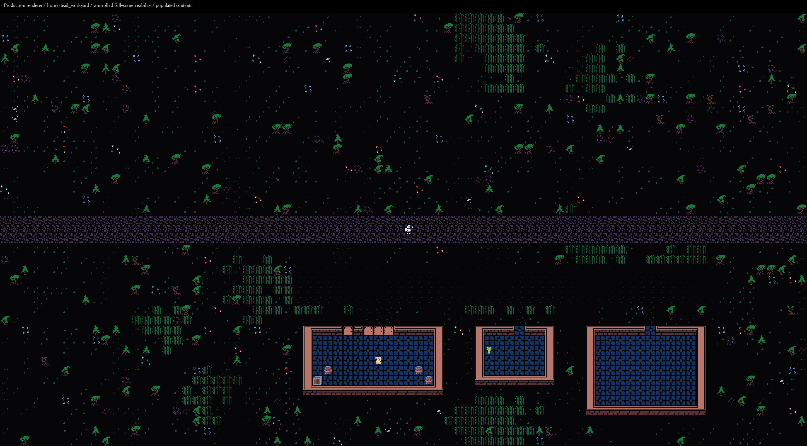
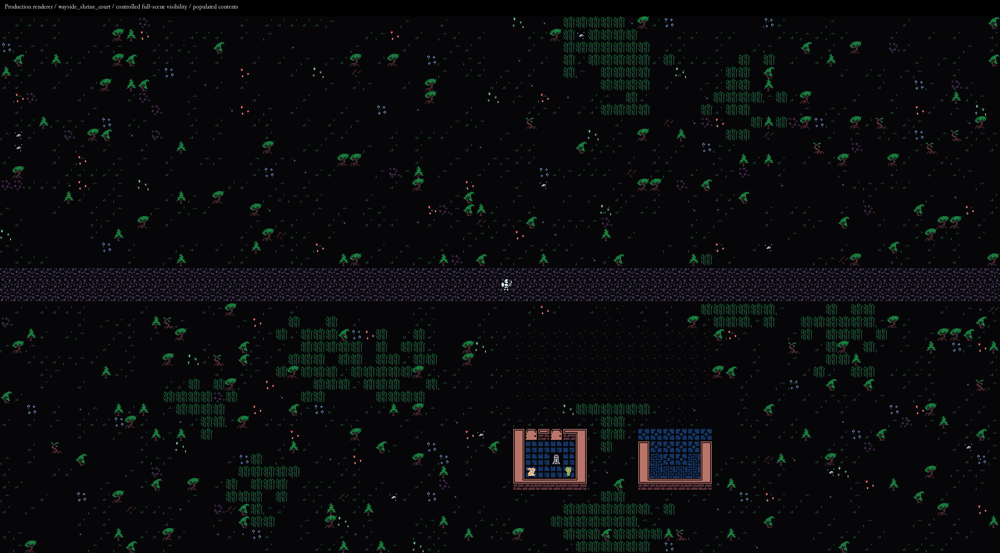

# G7 — Small compounds with shared country-road access

G7 adds two authored compound recipes to new worlds while retaining two through
four additional **parent destinations**, at least one compound and one single site.
The featured landmark remains separate. A parent owns one rural chunk, one external
country attachment and one protected envelope. Its two required children and at
most one optional child use explicit shared circulation and independent contents.

Work began on clean production `main` at
`4d7a7892e1afffb8d872ed4a8fd442984d14e7d5`, exactly the reviewed G6 reference.
The owner's request to execute the supplied brief defines this implementation and
delivery scope; the attachment's assertions about earlier approval are not treated
as independent evidence of prior acceptance. All work remains in the original
checkout on main. No branches, worktrees, additional development checkouts, desktop
control or personal campaigns were used. The external established interpreter
supplies dependencies only. G1–G6 evidence and the frozen editor corpus are preserved.

## Authoring and selection

The [complete authoring guide](../../roguelike/docs/STRUCTURE_AUTHORING.md#g7-compounds-a-place-with-shared-access-and-two-or-three-buildings)
contains six executable workflows and retains the G5/G6 workflows. Start with:

```powershell
$ResonancePython = 'G:\GameDev\RoguelikeBaseline-20261020\project\.venv\Scripts\python.exe'
& $ResonancePython -X utf8 tools/structure_authoring.py --init-compound authoring/g7
& $ResonancePython -X utf8 tools/structure_authoring.py --compound authoring/g7/g7_travellers_court.json --child authoring/g7/g7_wayhouse.json --assigned-compound S --output evidence/g7-owner/court.json
```

Initialization preserves edited files. Draft previews never install files. Recipes
live in `roguelike/data/generation/compounds/`, child layouts in the existing
building catalog, and parent selection in `roguelike/data/generation/poi_profiles.json`.
The complete example recipe, child and policy are in `roguelike/docs/examples/`.
Both headless browser engines exercise real child downloads and pass those bytes
to direct and whole-compound production previews.

| Recipe | Envelope | Legal parent turns | Children |
|---|---|---|---|
| `homestead_workyard` | 44×16 | 0°, 180° | Hearth house, tool shed; optional storehouse |
| `wayside_shrine_court` | 18×14 | 0°, 90°, 180°, 270° | Shrine and waymarker shelter |

The v2 policy uses one canonically ordered kind-tagged choice list. Default count
bounds remain 2..4, with explicit minimum-one-single/minimum-one-compound. A compound
counts once, regardless of child count. Each parent asset/recipe has a cap of two;
children do not consume single-site caps. Single parent weight is structure base
weight × policy weight; compound base is one (shipped policy weight two). Child
memberships independently use child base weight × slot weight. Transform counts
do not multiply parent or child asset weight. Nearest-parent repetition uses the
same-kind/ID key, Manhattan joins, stable parent-ID tie-break and multiplier .2.

The existing 80/24/12 join/town/junction spacing, 16-tile sampling lattice, 8192 raw
samples and 512 candidates remain. The shared 1024-attempt budget counts parent
transform trials plus child transform/backtracking trials. Each recipe separately
bounds a parent trial to 24 child attempts. Recipe admission first certifies all
declared rotations using the same bounded fitter; these validation trials are
separate from country-candidate work. Hard caps, finite candidates and budget
exhaustion have distinct diagnostics. All required total/kind minima must succeed
before publication. Optional omission records a reason and leaves no reservation,
plot, placement or dependency residue.

## Access, ownership and saves

`_plot` is still the building geometry solver. Its new explicit bounds/internal
access inputs avoid changing global town spacing or inventing a country road for
each child. Parent transforms respect the child's existing consumed permissions.
Private buffers fit their declared slots. Envelope containment uses an explicit
member roster; sibling or foreign private rows are never exempted by a parent-ID
prefix. Shared overlap is limited to named paths and actual public geometry.

Canonical paths are saved once in the `paths` registry. The derived sparse physical
road/access view includes parent approaches, paths and child approaches with
four-neighbour continuity. First materialization validates full primary/secondary
door spans and usable goals after all children, contents, dressing and native
population. A complete chunk scene remains the only mutable/cache/save owner.
Child placement IDs prefix content records, including same-asset children.

The controlled production-renderer overviews below include ordinary native turns
and populated contents. Visibility is revealed for review; these are not claimed
as unrestricted exploration screenshots.





Fresh compound-capable worlds use format 5 / `wg7`; `shared-v1`, `structure-v1`,
campaign storage and `native-town-v1` remain. Explicit v1 single-site policies retain
format-4 semantics. Saved plans never consult current recipes/policies to recompose
pending scenes. Changed consumed child definitions reject only affected unseen
scenes; visited scenes remain authoritative, including player mutations. Older
plans gain no parents. Explicit G3/G4/G5/G6-to-G7 adapters preserve actual visited
creator revisions and identify current materialization of pending scenes.

Before any implementation edit, a genuine G6 campaign captured one mutated visited
additional site and another pending site. The mutation was a **direct fixture
action**, not a claimed player interaction. The exact format-4 plan, checkpoint
archive, inventory, source hashes, provenance and fingerprint are retained in
`tools/critical_fix_regressions/fixtures/g7/`. The capture command succeeded; its
generic receipt flags source change because the command created the new fixture
outputs in the source-manifest search path. Original implementation bytes were
unchanged during capture. The original receipt is retained without rewriting it.

The supplied goal probe reproduced legal direct preview plus an empty
`StopIteration` in assigned/new-world selection. The admission checkpoint replaces
that with an asset/context/fix-bearing `GenerationError`, preserves optional goals
alongside required ones and leaves failed world publication unchanged. The untouched
probe and its original/before/after results are retained.

## Acceptance evidence

The [evidence index](../../evidence/worldgen-g7/INDEX.md) maps raw runs, receipts,
failures and archives. Tests below name behavior rather than relying on totals.

| ID | Implementation and exercised evidence |
|---|---|
| G7-01 | `before/start.json`, authentic G6 fixture/binding/capture, untouched goal probe, three real allowed workers and synthetic root rejection |
| G7-02 | `poi_selection.require_usable_goal`; both `G7Admission` tests; admission probe after correction |
| G7-03 | `compounds.validate_recipe`, both complete recipe JSONs; invalid recipes and all-rotation complete previews |
| G7-04 | `parent_selection.validate/populate`; kind/cap/explicit-zero tests and ordinary seed matrix |
| G7-05 | `parent_selection.eligible`, stable asset-first slot draws; canonical memberships/process hash seeds, capped policy and bounded-failure tests |
| G7-06 | Existing country candidates plus complete-envelope fitting; both axes/all legal rotations and ordinary saved attachments |
| G7-07 | Shared `world_plan._plot` explicit bounds/internal access; transform and wide-storehouse doorway checks |
| G7-08 | `Reservations` explicit envelope members and `compound_integrity` replay; independent sibling/foreign/private-path negatives |
| G7-09 | Staged parent search; required/global budgets, dependency failure, optional capacity/budget omission and exact no-residue assertions |
| G7-10 | Canonical path registry, exact country attachment and `PhysicalRoads`; independent corner/disconnected fixtures and foreign-path corruption |
| G7-11 | `planned_scene.validate_access`; all six recipe orientations, wide main/service doors, injected later-child container obstruction, native turns and production views |
| G7-12 | Format-5 reciprocal records, strict reservation replay, v1 historical tests and literal featured landmark checks |
| G7-13 | Saved recipe/policy removal leaves pending composition usable; consumed-child edit rejects affected unseen scenes with visited/unaffected positives |
| G7-14 | Authentic G6 visited/pending checkpoint test; retained genuine G5 checkpoint and G3/G4 adapter plus legacy tests |
| G7-15 | Two same-asset children in each of two same-recipe parents; reverse visits, distinct objects, four real item transfers, cold load and F9 |
| G7-16 | Real checksum-consistent save preparation corruptions; later-child obstruction preserves player/RNG/cache/actors/Chunk/world/HEAD with successful recovery |
| G7-17 | Ordinary seeds 0, 20261023, 29417: total/kind minima, complete scenes, goals, exact plans, costs and frequency denominators |
| G7-18 | Existing real-handler journey extended through country join, gate, every accepted compound child and a single site; earlier destinations and coherent F9 retained |
| G7-19 | `verify_g7_authoring.py` six workflows, inherited nested G6/G5, both browser engines and actual child-download consumers |
| G7-20 | Immutable input checkpoint, full serial release gates, raw/canonical-LF reconciliation, delivered commit/tag and remote readback |

## Verification record

The immutable tested input is
`e0be127cf0aaed9596c7a48b0ff5d68617a51c81`, tagged
`checkpoint/worldgen-g7-final-gate-inputs-20261024-a`. **All nine final serial gates
passed on these unchanged inputs.** The delivered commit is resolved by
`checkpoint/worldgen-g7-verified-20261024-a`; its final publication is independently
read back from the remote. Development runs remain separate from release results.

All 680 tested inputs reconcile to Git: **437 exact raw matches and 243
line-ending-only matches**. Canonical text comparison replaces CRLF with LF, then
remaining CR with LF, and changes nothing else. Binary inputs remain exact.
`STRUCTURE_AUTHORING.md` has mixed endings, so its raw tested bytes are retained in
every final gate's archive and in `source-raw/`, protected from Git normalization.
Its raw SHA-256 is
`c6dc3f3407039471a426ae5c739bd6abd50c5e293d4ef9b41b8ca394caab028e`;
its canonical-LF SHA-256 is
`2ef5e169f5b5c0f75873b8f32f2b26bf29b806f1525eaf7aadf58e89cebed726`.
This closes the tested-document ambiguity for G7 without claiming recovery of
the unavailable historical G6 representation.

The retained development history includes an interrupted duplicate-discovery run,
an incorrectly authored disconnected-gate negative fixture, and a first broad
focused run that reached the old 600-second timeout. That broad run also exposed
four inherited cohort subcases routing the newly admitted `compound` context into
the settlement-only preview. The corrected cohort test now exercises each such
asset through its actual complete parent. The expanded suite has a finite
1200-second limit; the outer release wrapper has a finite 1800-second limit.
These are disclosed timeout changes, not passing results for the interrupted run.
The targeted cohort, recipe-negative and membership/process determinism recheck
passed three tests in 139.95 seconds with stable source.
Early exploratory CLI errors preceded wrapper instrumentation and remain in the
chat's tool history rather than a complete standalone source replay. Wrapped
development attempts and every final gate retain their input bindings; the final
release claims rely on the latter.

The final command ran from `G:\GameDev\RoguelikeProject` with the established
Python 3.11 environment:

```powershell
& $ResonancePython -X utf8 tools/verify_g7_release.py --evidence evidence/worldgen-g7/final-a
```

Its children run serially: guard preflight, normal focused discovery, both browser
engines, six authoring workflows (including inherited workflows), catalog,
editor-catalog freshness, ordinary diagnostics plus real journey, diagram rendering,
and the unfiltered production gate. Each command has its own complete receipt.

The focused run passed **202 tests, zero failures/errors/skips**, in 433.93 seconds
(436.69 seconds including its wrapper). Chromium 156.0.8078.4 and Firefox 157.0 each
passed 41 checks with Playwright 1.64.1 and its RECORD-verified bundled driver
`1.64.0-beta-1791568591000`. G7 authoring passed 28 commands,
including nine expected negatives; inherited G6 records contain 19 commands/five
expected negatives and nested G5 records contain 22 commands/one expected negative.
Nested wrapper calls are not counted again as independent top-level workflows.
The catalog passed with 64 assets and 238 retained diagnostics; editor freshness
passed. The diagnostics are existing advisory/inactive-field notices, not failed
runtime admissions.

The unfiltered production gate passed **3,675/3,675 checks, 159/159 valid workers
and all 74 coverage groups**, with seven runner-negative controls and thirteen
intentional crash workers handled as expected. Its wrapper took 427.83 seconds.
The preflight separately passed three workers/59 checks and rejected the synthetic
outside-root job before save access. The known `UI-TEXT-HEIGHT` issue remains the
explicit production UI deferral; it is not a G7 generation failure.

The nine gate wrapper times were: guard 18.59 s, focused 436.69 s, browser 44.22 s,
authoring 63.72 s, catalog 0.33 s, catalog freshness 0.31 s, diagnostics/journey
134.27 s, diagram rendering 1.14 s and production 427.83 s. Every receipt reports
stable source, exit zero, no timeout, and successful committed-input reconciliation.
Both evidence ZIPs were CRC-checked and every retained member was re-read and
hashed: 523 development members and 735 final members. Their inventories explicitly
exclude 67 and 2,163 disposable worker files respectively. Opening capture runtime
omissions have a separate inventory; the authentic checkpoint fixture is preserved.

### Ordinary selection and observed costs

The denominator is three ordinary seeded worlds, eight accepted additional
parents, four compound parents and nine accepted compound children. The featured
landmark is excluded from those parent counts. No optional slots were omitted in
this ordinary sample; controlled tests separately prove both omission modes.

| Seed | Desired / accepted parents | Singles / compounds | Homesteads / shrine courts | Children | Timed complete scenes |
|---|---:|---:|---:|---:|---:|
| 0 | 2 / 2 | 1 / 1 | 1 / 0 | 3 | 15 |
| 20261023 | 3 / 3 | 2 / 1 | 0 / 1 | 2 | 18 |
| 29417 | 3 / 3 | 1 / 2 | 0 / 2 | 4 | 18 |

Observed child counts are hearth house 1, tool shed 1, storehouse 1, shrine 3 and
waymarker shelter 3. These are small-sample observations, not estimates of policy
probabilities. Every world has one physical access component and zero created
local scenes at planning completion. Timed scenes include the start, all town
members, landmark, capital gateway and all parents; the crossing is checked
separately. Exact transforms, attachments, paths, goals, rejected candidates and
frequency denominators remain in the raw run record.

| Seed | Compact plan bytes | Registry/policy/path bytes | Planning seconds | Parent + child trials | Candidate fitting seconds | Slowest sampled scene seconds |
|---|---:|---:|---:|---:|---:|---:|
| 0 | 600,599 | 3,296 | 0.777 | 2 + 3 | 0.0043 | 0.1854 |
| 20261023 | 738,766 | 4,074 | 1.071 | 4 + 2 | 0.0054 | 0.1866 |
| 29417 | 679,457 | 5,153 | 0.856 | 4 + 4 | 0.0059 | 0.1867 |

Candidate enumeration took 0.023–0.056 seconds and derived connectivity took
0.035–0.075 seconds. Fitting time combines parent and child work; admission
certification is included in broader planning/enumeration, not those trial counts.
Registry/policy/path bytes exclude flat child placement/plot/reservation records.
The final summary separately sizes those persisted subtrees and compares the
authentic G6 plan for seed 20261023. Whole-plan growth is not attributed entirely
to compound metadata.
That genuine G6 plan was 735,062 compact bytes, versus 738,766 for G7: a net increase
of 3,704 bytes with changed composition, not an isolated per-compound byte cost.

The final journey dispatched **38,415 actual movement inputs**, retained native
actors as obstacles, crossed the required bridge, visited both settlements and
the landmark, then traversed the compound gate/shared path/both children and one
single site. Both child containers and the single-site container used actual
interaction handlers. The worst observed transition was 0.2083 seconds. Its
18,978,098-byte checkpoint took 0.7857 seconds and contained **two starting scenes**, before the journey;
352 scenes were materialized before coherent F9 restoration, which took 0.5513
seconds. This does not claim that all 352 scenes were checkpointed.

The separate explored-compound lifecycle checkpoint contained **four scenes**
(two startup plus two compound scenes), 19,993,958 bytes, four independent
same-asset child item transfers, 0.7452-second save and 0.6962-second cold load.
Cold load and F9 both preserved each child's mutation. All timings are observations
from this serial run, not a cross-platform or cold-cache performance comparison.

## Limits and next review

These compounds stay within one 80×43 chunk in a finite 128×128 world. Candidate
truncation is bounded sampling, not an exhaustive fit proof. Physical access
projection is distinct from final interaction access. Long journey controls pause
AI/survival and retain stationary actors; a separate ordinary-update positive runs
native updates. Controlled renderer overviews reveal visibility and show actual
populated production scenes, not unrestricted exploration screenshots.

Save measurements disclose their scene counts. A two-starting-scene checkpoint is
not a benchmark of a later explored campaign; the separate controlled lifecycle
checkpoint includes both explored compound scenes. No Linux-versus-Windows timing
comparison is presented as a regression claim. `UI-TEXT-HEIGHT`, larger-world
retention/streaming and continuous viewport remain deferred. Stop at G7: the next
review should assess composition and authoring before selecting richer settlements
or street work. No later-arc implementation brief is included.
