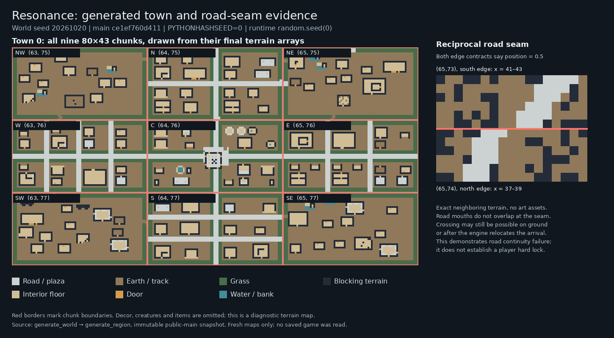

# Resonance world generation audit and proposal

**Source:** `main` at [`ce1ef760d411a0d1e9dfec93f1addf149955ac8c`](https://github.com/dgobi/ResonanceRoguelike/commit/ce1ef760d411a0d1e9dfec93f1addf149955ac8c), inspected 23 October 2026. This is a design proposal and source audit for owner review. It does not apply a game change or constitute a set of implementation briefs.

> Historical audit and broader proposal retained from the supplied review. G1 now implements the bounded correctness repairs; [WORLDGEN_G1](WORLDGEN_G1.md) is the current implementation/evidence record. The planner, schema and authoring roadmap below remains proposed, not implemented.

## Recommendation

Make world generation the next substantial development target, beginning with its correctness and authoring boundaries. Preserve the existing JSON content, the current Python engine, and the persistence repairs. Build an explicit hierarchy of geography, travel networks, settlement plans, plots, and authored structures. Generate local tiles from those plans, then verify that the resulting playable world fulfills the plan.

The key missing concept is **a placement contract**: an asset must describe the space it occupies, the access it requires, the surroundings it tolerates, and the connections it offers. A building can be perfectly valid JSON and still be unsuitable for a particular plot. A visible road can cross a map border and still fail to connect to the next map. These are different checks and must have different owners.

The current world is already large in potential tile area. Its default 128 × 128 chunk metadata grid, with 80 × 43 local maps, represents 10,240 × 5,504 tile positions: 56,360,960 surface positions before underground areas. These are potential positions, not tiles all held in memory. A genuinely convincing portion of this world is a better first target than increasing its extent. Preserve the ability to change the planning and storage scales later.

## 1. What the pushed fixes establish

All ten runtime payloads from the critical-fix package match the pushed files after newline normalization. All 21 package code, documentation and test payloads also match the committed verification manifest after that normalization. The repository records 66 focused tests and a full Windows D gate of 159 workers and 3,675 checks; the compressed gate evidence was decoded and its recorded digest checked. Those are the repository's recorded run results; the new world-generation probes described here are a separate audit.

The fixes preserve explicit checkpoints during travel, enforce interaction and stair input boundaries, correct transfer action costs and ingredient allocation, preserve effect and pursuer state, unify relevant melee behavior, retain stable creature identities, and correct font path case. The prior text-reader height defect remains deferred. The source and evidence are in [CRITICAL_FIXES_VERIFICATION.md](https://github.com/dgobi/ResonanceRoguelike/blob/ce1ef760d411a0d1e9dfec93f1addf149955ac8c/docs/owner/CRITICAL_FIXES_VERIFICATION.md).

Passing those gates does not certify world generation. They exercise different contracts. The new findings below concern generated content, authored data routes, access, determinism, and scale.

### How this changes the previous next-arc recommendation

The committed [NEXT_ARC.md](https://github.com/dgobi/ResonanceRoguelike/blob/ce1ef760d411a0d1e9dfec93f1addf149955ac8c/roguelike/docs/owner/NEXT_ARC.md) proposes the preserved text-height defect as a possible next bounded task and lists decay/butchery content, weapon behavior, RNG replay, save migration and checkpoint pruning as separate follow-ups. Those items remain individually valid. The user's clarified priority and this audit put **generation correctness, dependable structure authoring, and connected world composition** ahead of expanding combat or survival content. The small text-height repair can remain independent; it does not need to become a prerequisite for planning the world.

Full gameplay RNG replay also remains a separate policy decision. Deterministic geography and initial generated content are the more immediate needs. Checkpoint growth becomes relevant as exploration expands, while personal-save migration still requires its own explicit scope. This proposal updates the development order without treating the earlier B–D repairs as unfinished or reopening every deferred feature.

## 2. Existing architecture

The existing system has several useful layers. It is more developed than an undifferentiated bag of buildings, but its layers do not yet share enough placement and connectivity information.

| Layer | Present responsibility | Boundary that needs strengthening |
|---|---|---|
| World metadata | Elevation, moisture, biome, rivers, capital, towns, roads, submaps, myth | Stable planning identity; geographic constraints and reserved sites |
| Chunk metadata | Seed, biome, town role, road/river connectors, submap links | Exact reciprocal boundary geometry and complete generation status |
| Town generator | 3 × 3 roles, central plaza, cardinal arteries, secondary streets, row packing, corner scatter | One settlement plan spanning all chunks; plot frontage and access |
| Building definitions | Authored terrain and decor plus supported item/container specifications | Validated common schema, whole footprint, transformed entrance coordinates |
| Terrain fill | Biome generation and small WFC ground palettes | Boundary conditioning, observable failure and valid fallback |
| Engine population | Instantiate actors and objects from generated specifications | One authoritative materialization path, independent of the first visitor |
| Scene cache and checkpoint system | Preserve generated and modified maps and actors | Generation versioning and bounded long-campaign storage and memory |

Main source entry points are [world_gen.py](https://github.com/dgobi/ResonanceRoguelike/blob/ce1ef760d411a0d1e9dfec93f1addf149955ac8c/roguelike/generation/world_gen.py), [region_gen.py](https://github.com/dgobi/ResonanceRoguelike/blob/ce1ef760d411a0d1e9dfec93f1addf149955ac8c/roguelike/generation/region_gen.py), [town_gen.py](https://github.com/dgobi/ResonanceRoguelike/blob/ce1ef760d411a0d1e9dfec93f1addf149955ac8c/roguelike/generation/town_gen.py), [local_gen.py](https://github.com/dgobi/ResonanceRoguelike/blob/ce1ef760d411a0d1e9dfec93f1addf149955ac8c/roguelike/generation/local_gen.py), and [layout_stamper.py](https://github.com/dgobi/ResonanceRoguelike/blob/ce1ef760d411a0d1e9dfec93f1addf149955ac8c/roguelike/generation/layout_stamper.py).

### Authored content is divided among several consumers

There are 57 building JSON files in eight category folders, six surface entrance variants, one authored submap layout, and eleven container loot pools in the audited source. Town buildings, plazas, surface entrances, named underground maps, and the old structure helper do not all consume the same schema. A capability in one stamper is not automatically available in the others.

In particular, the active town packer takes raw category lists. Its centre/cardinal row packing chooses uniformly among fitting definitions, bypassing the older loader's `allowed_in` selection logic and per-building weighting. The `wilderness` category contributes to town-corner scatter; its name does not establish general roadside or forest placement. The supplied `town_config.json` is loaded, while the active values are still constants in Python. These are reasons that plausible edits can appear to have no effect.

The companion [STRUCTURE_AUTHORING.md](../../roguelike/docs/STRUCTURE_AUTHORING.md) documents the current working route, includes a complete validated example, and distinguishes active fields from unsupported or inactive ones. `CAPITAL` currently follows the open-terrain route; its world-map identity does not yet imply a developed urban layout.

## 3. Audit findings and evidence

### Demonstrated defects and authoring failures

| Finding | Observed evidence | Consequence and priority |
|---|---|---|
| A migrating creature can cause permanent missing population | For the same town chunk, ordinary player-first entry produced six native creatures, 21 containers and ten floor items. Creature-first generation cached the same terrain with only the migrant; subsequent player entry had zero containers and zero floor items. TownData still declared the missing content. | **Repair first.** Terrain generation and population are split across inconsistent entry routes. A cached map can be mistaken for a completed scene. |
| Some authored interiors have no usable perimeter entrance | In a 36-chunk, four-town sample with 483 placements, 66 hovel and 16 hunter-cabin placements had sealed interiors. The authored templates put their doors inside enclosing perimeter walls. Both templates include notes inside. The reachability check allowed eight-way movement, openable doors and honored blocking decor. | **Repair first.** These are content-access defects in the reusable templates, amplified every time the assets are selected. |
| Road metadata agrees while the actual road does not | World seed 20261023 had reciprocal road metadata on all 185 shared road edges. In a bounded sample of twelve wilderness road seams, eleven tile masks differed and five were disjoint. At (22,70) → (23,70), the two road mouths occupy y=18–20 and y=23–24. Changing connector positions from 0.1 to 0.9 did not change the carved terrain. | **Repair before expansion.** Road carving discards the stored position and independently jitters endpoints. This proves a continuity defect, not that every such boundary traps the player. |
| Internal town paths are also independently planned | In world seed 20261020, twenty of 48 internal seams in the four generated towns had no shared road/track border coordinate. Main arteries often align; corner tracks and other local decisions do not establish a complete shared contract. | **Repair the seam rule, then replace chunk-local layout decisions with a settlement plan.** These counts describe one world, not an estimated universal failure rate. |
| Authored town scenes disappear in the engine adapter | A real generated `interrupted_meal` scene at town chunk (65,75), local (8,7), should contribute dried provisions and a water skin. Execution of the actual debug teleport adapter produced neither and attempted to create an empty item ID. Source inspection confirms the same missing scene branch in normal boundary entry. | **Repair before adding scene-rich structures.** Collected specifications are not sufficient evidence that content appears in play. |
| Weighted town specials crash when an author starts using them | A synthetic one-entry weighted special passed to the actual town stamper raises `NameError: name 'rng' is not defined`. No shipped building currently uses that special type. | **Authoring blocker, latent in existing content.** Correct the consumer or reject the unsupported type explicitly; do not teach it as working today. |
| Generation is not completely seed-owned | Two fresh processes with the same chunk seed and different Python hash seeds changed decor at 195 forest positions and 67 town positions. An isolated actual WFC fill changed 125 of 192 terrain positions. Three same-seed dungeon calls produced different partitions, with 25, 26 and 29 rooms. | **Repair before relying on regeneration or extending the world.** Process-salted hashes affect variants and town WFC; the BSP call does not receive the intended tcod RNG. The sampled full town terrain itself did not change in the hash test. |
| Outskirts WFC can silently abandon its intended result | With fixed `PYTHONHASHSEED=0`, seeds 0–9 and the actual 74 × 37 outskirts fill rectangle, all ten solves exhausted their ten attempts. The caller uses packed-earth fallback. Smaller block/plaza probes also had failures. | **Correctness/quality repair.** Diagnose palette compatibility and make fallback visible. Increasing retry count is not a proven solution. This is a controlled sample, not a claim that every world fails. |
| The layout painter does not preserve the runtime contract | Executing its actual import/export functions with the valid example changed nested decor ID arrays into strings, dropped width, height and special tiles, and caused the actual stamper to record individual characters as invalid decor IDs. | **Repair before recommending the painter for finished assets.** The probe verifies serialization behavior, not the browser's visual UI. Terrain sketches can still be useful with a careful JSON merge. |
| Initial surface generation omits data-dependent content | The same starting-region fixture produced zero flint when called as startup does, compared with seven when called with the normal data argument. | **Repair alongside the common scene entry path.** The world should not acquire different resource rules because one map was the initial surface. |

The access probe found 113 of 483 placements with at least one unreachable otherwise-enterable cell: 66 hovels, sixteen hunter cabins, six saint alcoves, four foundation outlines and 21 docks. This broader count is **not** a count of 113 completely inaccessible houses. Docks can have isolated cells and ruins may intentionally enclose space. The hovel/cabin examples and their inaccessible authored notes are the clear repair targets; the other assets need their intended access classified.

### Existing safeguards that worked in the sample

The same 483-placement sample had no pairwise rectangular building-footprint overlaps and no blocked returned player spawn positions. All 185 road edges in the separate metadata world had a reverse connector with the same position. These results support retaining the useful packing and world-graph work. The failures arise when those intentions are translated into local geometry and contents.

The diagnostic below is drawn from final terrain arrays. It is not a game-art mockup. The right-hand example has no river tiles and shows disjoint road mouths across a reciprocal connection. The engine may still permit crossing over other ground or relocate an arrival, so the figure does not establish a player hard lock.



### Schema inconsistencies and placement risks

The static content scan found eight declared dimension/grid mismatches and two ragged grids. Some current stampers calculate dimensions from the rows, so a mismatch is not automatically a crash. It is still unsafe authoring guidance and becomes hazardous wherever another consumer trusts the declared size. The scan also found six shipped scene/body/stele special entries whose intended behavior is not realized by the active town route. Two unknown `town_plaza` legend entries are unused in their actual rows; they are catalog inconsistencies, not demonstrated missing terrain.

Surface entrance placement checks a candidate center and then stamps a whole structure. It does not reserve or validate the entire footprint against roads, buildings or other critical sites. This is a **source-confirmed missing safeguard**; this audit did not reproduce a resulting overwritten staircase. It belongs in the placement contract, rather than being presented as an observed corruption incident.

The road/river crossing code already has crossing behavior. A ford made mostly of `river_water` is not automatically broken: this terrain is currently walkable for the player while creature passage has separate rules. No impassable-ford claim is made here. The proposal adds explicit crossing identity and validation because terrain overwrite order is insufficient as the long-term contract.

Town placement's documented target and near-start guarantees are also weaker than their wording. Across 21 metadata worlds, two lacked a town center within the claimed distance fourteen and five contained more than four towns. The additional near-start pass can append a town after the original target-count pass. These are bounded world-planning inconsistencies, lower priority than missing content or inaccessible authored goals.

Candidate selection also favors the order of the scanned coordinates: a stable sort by a coarse biome score precedes selection of the first feasible location. This is a source-confirmed distribution bias, supported by the small metadata sample, rather than a measured universal placement rate. In the four fully generated towns, every central plaza's physical bell was cracked while the four stored bell states were spent, intact, spent and destroyed. That inconsistency matters because the metadata also drives guardian eligibility and proximity messages. A settlement's visible anchors and gameplay state need one owner.

### Scale and simulation policies

These are design limits and policy decisions, rather than claims that the recently repaired save system has regressed:

- The world seed is persisted correctly. The gaps are other random sources and the lack of an explicit generator/content version contract. Save schema validation alone does not define procedural compatibility.
- The measured 128 × 128 world serialized to about 15.4 MB of pretty-printed metadata before local scenes. It assigned 16,384 chunks from a million-value chunk-seed range, with 128 duplicate draws in that world. Coordinate-keyed generation would remove this avoidable repetition source.
- An empty 80 × 43 LocalMap pickle measured about 496 KB in this runtime. Surface hot maps have a distance eviction path; submaps do not share that bound. A probe evicted all surface entries while retaining all eight hot submaps.
- Three checkpoints in a tiny two-scene fixture retained the same approximately 0.99 MB of scene blobs in each generation. Current snapshots and session history are retained until retirement. This is a real growth mechanism, not a projection of a measured full campaign's disk usage.
- Processing and zones advance on hot inactive maps but remain frozen on cold maps. In a checkpoint replay, one subsequent turn changed a hot countdown from three to two; after load made that map cold, it stayed at three at the same world turn. Inactive actor suppression remained three in both paths. These systems therefore have distinct clock policies, and cache residency influences some outcomes. A huge world needs an explicit choice about active simulation, elapsed-time catch-up and deliberate freezing.
- The current reality-bubble metadata does not yet provide general neighboring-chunk actor simulation: ordinary actors are processed in the current scene, with explicit pursuit exceptions.
- Initial container loot uses the gameplay RNG. Consuming 100 prior engine RNG draws changed the contents of all 21 sampled town containers while leaving terrain unchanged. Engine RNG position is not restored by checkpoints, and AI has a separate entropy-seeded RNG. These are reproducibility-policy limits; exact replay of all future gameplay is not automatically a requirement.

Checkpoint work also grows with visited content: saving collects all scene payloads in memory, and loading validates every saved scene before installing the active one. Startup generates an initial world before replacing it with the saved world. These paths need measurement and bounded work before world extent increases. The audit demonstrates the work performed, not a particular target-machine failure threshold.

### Evidence index and scope

The accompanying evidence package contains the exact probe scripts and JSON results. Test files are review tools outside the game checkout; no game source, personal save, branch or remote repository was modified.

| Evidence | Purpose |
|---|---|
| `world_state/landed_evidence_check.json` and `priority_fix_identity.json` | Package payload identity and recorded production-gate integrity |
| `world_state/world_state.json` | First visitor, BSP seed ownership, hot/cold clock, cache and checkpoint fixtures |
| `world_state/world_contract.json` | One real-world metadata sample, connector masks and startup data parity |
| `world_state/hash_determinism.json` | Independent-process hash-seed comparison |
| `world_state/world_rng.json` | Initial loot dependence on prior gameplay draws and absent RNG-position replay |
| `town_roads/results.json` | World placement sample, town materialization and footprint/road observations |
| `town_roads/access_and_scene_results.json` | Movement-aware interior access and actual scene-adapter result |
| `authoring/catalog_audit.json` and `contract_probes.json` | Asset census, inconsistencies, weighted special and painter round trip |
| `authoring/validation.json` | Complete working example through real loading, stamping and selection |
| `wfc_repeatable_probe.json` | Fixed-hash, bounded WFC reliability probe |

These diagnostics are designed to reproduce specific boundaries. They do not claim exhaustive seed coverage, rendered UI coverage, cross-platform bitwise reproducibility, or a full new world-generation acceptance gate.

### Source map for the principal findings

All links below point to the immutable audited commit. The evidence archive includes the fuller subsystem notes and reproduction commands.

| Finding or subsystem | Source |
|---|---|
| First visitor and native population | [Creature-first creation](https://github.com/dgobi/ResonanceRoguelike/blob/ce1ef760d411a0d1e9dfec93f1addf149955ac8c/roguelike/engine/engine.py#L2935-L2981); [normal entry](https://github.com/dgobi/ResonanceRoguelike/blob/ce1ef760d411a0d1e9dfec93f1addf149955ac8c/roguelike/engine/engine.py#L2180-L2231); [startup surface](https://github.com/dgobi/ResonanceRoguelike/blob/ce1ef760d411a0d1e9dfec93f1addf149955ac8c/roguelike/main.py#L65-L67) |
| Road metadata and local carving | [World connectors](https://github.com/dgobi/ResonanceRoguelike/blob/ce1ef760d411a0d1e9dfec93f1addf149955ac8c/roguelike/generation/world_gen.py#L489-L536); [endpoint jitter](https://github.com/dgobi/ResonanceRoguelike/blob/ce1ef760d411a0d1e9dfec93f1addf149955ac8c/roguelike/generation/local_gen.py#L489-L499); [connector consumption](https://github.com/dgobi/ResonanceRoguelike/blob/ce1ef760d411a0d1e9dfec93f1addf149955ac8c/roguelike/generation/local_gen.py#L594-L658) |
| Town pool selection and specials | [Role layouts and pools](https://github.com/dgobi/ResonanceRoguelike/blob/ce1ef760d411a0d1e9dfec93f1addf149955ac8c/roguelike/generation/town_gen.py#L906-L1059); [ordinary stamping](https://github.com/dgobi/ResonanceRoguelike/blob/ce1ef760d411a0d1e9dfec93f1addf149955ac8c/roguelike/generation/town_gen.py#L1688-L1775) |
| Authoring editor serialization | [Painter export](https://github.com/dgobi/ResonanceRoguelike/blob/ce1ef760d411a0d1e9dfec93f1addf149955ac8c/layout_painter.html#L553-L574); [painter import](https://github.com/dgobi/ResonanceRoguelike/blob/ce1ef760d411a0d1e9dfec93f1addf149955ac8c/layout_painter.html#L591-L642) |
| Seed ownership | [World seed](https://github.com/dgobi/ResonanceRoguelike/blob/ce1ef760d411a0d1e9dfec93f1addf149955ac8c/roguelike/main.py#L40-L53); [functional decor hash](https://github.com/dgobi/ResonanceRoguelike/blob/ce1ef760d411a0d1e9dfec93f1addf149955ac8c/roguelike/rendering/decor.py#L83-L99); [BSP partition](https://github.com/dgobi/ResonanceRoguelike/blob/ce1ef760d411a0d1e9dfec93f1addf149955ac8c/roguelike/generation/local_gen.py#L300-L351) |
| Entrance footprint | [Interior entrance placement](https://github.com/dgobi/ResonanceRoguelike/blob/ce1ef760d411a0d1e9dfec93f1addf149955ac8c/roguelike/generation/region_gen.py#L404-L480) |
| Cache and checkpoint growth | [Cache eviction and snapshots](https://github.com/dgobi/ResonanceRoguelike/blob/ce1ef760d411a0d1e9dfec93f1addf149955ac8c/roguelike/engine/save_manager.py#L192-L235); [save/load work](https://github.com/dgobi/ResonanceRoguelike/blob/ce1ef760d411a0d1e9dfec93f1addf149955ac8c/roguelike/engine/save_manager.py#L304-L370) |

The sealed-template evidence identifies each placement and its asset ID in `town_roads/access_and_scene_results.json`; the complete asset paths and catalog inconsistencies are in `authoring/catalog_audit.json`.

## 4. Research and its relevance

This review combines primary research with documentation from systems that actually compose authored content. Publication date and technical fit both matter. A recent model that produces a plausible image does not establish a guarantee that a playable door connects to a road. The decisions below are my recommendations for Resonance, informed by the cited work.

| Source | Relevant result | Application and limit for Resonance |
|---|---|---|
| Chen et al., **Interactive Procedural Street Modeling**, SIGGRAPH 2008 [R1] | Guides road graphs using tensor fields and distinguishes major and minor streets. | Preserve a road graph above terrain tiles. Direction fields can later give districts different orientations; a tensor solver is not necessary for the first rectangular town plan. |
| Vanegas et al., **Procedural Generation of Parcels in Urban Modeling**, 2012 [R2] | Treats subdivision of street blocks into plots as its own controllable modeling problem. | Make plots with frontage, depth and access explicit before selecting buildings. Rectangular tile plots are a suitable first implementation. |
| Alaka and Bidarra, **Hierarchical Semantic Wave Function Collapse**, FDG 2023 [R3] | Adds semantic groups and intermediate choices to WFC's flat tile vocabulary. | Useful for districts, room types and authoring tools. It does not by itself establish a travel network or persistence policy. |
| Alaka and Bidarra, **Mixed-initiative generation of virtual worlds**, FDG 2024 [R4] | An 18-participant comparison found improvements in perceived performance, effort and frustration with the hierarchical editor; not all measured differences were significant. | Supports an editor based on understandable concepts and visible constraints. It is a small user study, not a runtime world-generation benchmark. |
| Nie et al., **Extend Wave Function Collapse to Large-Scale Content Generation**, CoG 2023 [R5] | Uses bounded interior solves and specially prepared complete/sub-complete tilesets. | Its guarantees depend on those tileset conditions. Its “determinacy” concerns not backtracking published subgrids; it is not a substitute for proving arbitrary exploration-order reproducibility in Resonance. |
| Marian Kleineberg, **Generating an infinite world with WFC**, 2023 [R6] | Uses compatible precomputed patches, constrained replacement and a valid retained fallback. | Adopt the principle of bounded work and a known-valid fallback. Arbitrary JSON buildings do not automatically form the required compatible patch library. |
| DeBroglie official path-constraint documentation [R7] | Distinguishes connected, loop and acyclic constraints; path constraints can need more computation and backtracking. | Local adjacency alone is insufficient. Reserve required connections first and validate actual navigation after stamping; use bounded constraint solving where it earns its cost. |
| Cataclysm: DDA official overmap and mapgen documentation [R8] | Separates coarse placement from local layouts; describes connections and required/optional joins between authored pieces. | This is the closest practical reference for the JSON-driven tile-world goal. Borrow the division of responsibilities and explicit joins, while retaining Resonance's own schema and mechanics. |
| Epic official PCG generation-mode documentation [R9] | Separates generation at multiple spatial scales and creates/cleans nearby detail around generation sources. | Plan at large scales and materialize at small scales. These are architectural lessons for the existing engine, not a reason to change engines. |
| Niu et al., **Controllable Generation of Large-Scale 3D Urban Layouts with Semantic and Structural Guidance**, September 2025 preprint [R10] | Generates building layouts conditioned on block/road boundaries and land use. | Semantics and upstream boundaries matter. Simplified building geometry and planning objectives do not certify traversable authored interiors. |
| Li et al., **RoadWeaver**, August 2026 preprint [R11] | Combines a generated skeleton with procedural graph expansion and topology repair; reports 99.8% reachability. | The useful lesson is the explicit graph/repair pipeline. The reported result is not 100%, uses high-end workstation hardware, and is not a guarantee for this game. The paper says implementation release is pending acceptance. |
| Shariatpour et al., **Procedural generation as an approach for digital representation of a city**, April 2026 [R12] | Evaluates a rule-based road/block/parcel/building workflow across grid, organic and radial forms. | A recent example of the continued usefulness of an explicit hierarchy. Its CityEngine case-study timings cannot be transferred to Python tile generation. |
| Salmon et al., **Parallel Random Numbers: As Easy as 1, 2, 3**, SC11, and Random123 documentation [R13] | Demonstrates stateless, indexed random generation. | Use stable keyed decisions and independent generation streams. No Random123 package dependency is required to adopt stable identities and avoid process-salted hashes. |

### Recommended combination

Use a **graph and plot planner with explicit structure connections**, plus limited procedural detail. This makes the road system and each structure's access inspectable. WFC remains useful for local patterns after the required geometry is fixed. A bounded local constraint search can fit difficult collections of buildings, but the whole world should not become one solver problem.

Learned urban generators are useful research references and may eventually support offline exploration of styles. Their training data, inference cost, representation differences and repair requirements offer little immediate advantage for the current finite, two-dimensional, authored-content project. The graph/plot approach directly addresses the failures this audit identifies and keeps the owner's JSON assets useful.

## 5. Proposed world-generation architecture

### 5.1 Define separate planning and simulation scales

Keep three independent concepts: a planning region, a storage chunk, and the active simulation area. A settlement may span several storage chunks. A road may cross many regions. Neither should be designed separately inside each 80 × 43 screen.

Use integer world-tile coordinates as the common geometry. With the present dimensions, `global_x = chunk_x * 80 + local_x` and `global_y = chunk_y * 43 + local_y`. The rectangular chunk shape matters; code must not use the width for both axes. Plans can then be clipped into storage chunks without changing their topology.

Initially retain a finite coarse world plan. The current potential area is ample for proving variety, density, and travel. Later, sparsely stored planning regions could extend it. Region generation would need an explicit cross-region backbone and shared reservations. Hashing a boundary to choose matching exits does not alone guarantee that all regions belong to one connected road system.

### 5.2 Plan geography and reserve anchors

Generate elevation, moisture, biome transitions, rivers and usable crossings in world coordinates. Preserve the project's meaningful anchors, including VUKH, the capital, and the starting laboratory. Reserve their footprints and required access before ordinary settlements and incidental structures.

A region should expose continuous environmental fields or a shared border strip to local generation. Sampling those fields at world coordinates avoids each chunk inventing unrelated edge terrain. Distinguish a genuine ecological transition from an accidental chunk border.

Do not begin with a full erosion or historical civilization simulation. Terrain needs to supply useful costs, barriers and opportunities for the road and settlement planners. More sophisticated terrain can be added once those interfaces exist.

### 5.3 Build a strategic travel graph

Represent settlements, important landmarks, bridge sites and important junctions as nodes. Roads are edges with identity, class, width, route and crossing rules. Select a connected backbone among intended connected destinations, then add useful loops and secondary links. A spanning-tree starting point is simple; loop selection can improve detours and give exploration choices. Intentionally isolated sites should be marked as such.

Route edges over terrain using a bounded cost search. Cost should account for length, slope, wetlands, existing roads and expensive crossings. Existing roads should be attractive to join, without making every new road collapse onto the same line. A river crossing should become an explicit bridge or ford object with approaches and width, rather than an accidental sequence of terrain overwrites.

The route is decided once. Each chunk receives the part of that route intersecting it, including the same width and boundary coordinates. If a required route cannot meet its constraints, revise the plan or fail generation before publication. Only sites explicitly designated as optional or isolated may remain disconnected. Player relocation must not count as evidence that a planned route joins correctly.

A shared boundary record should identify the feature, its exact crossing band, width, travel class and approach direction. A river also needs consistent banks and crossing ownership. This record is addressed canonically, so both sides read the same object. It supplements the larger route graph; independently matching exits at every boundary would still not prove that all required destinations belong to the intended connected network.

### 5.4 Plan each settlement as one place

Create a persistent settlement plan before its first local chunk is materialized. It owns incoming road attachments, primary streets, junctions, civic anchors, districts, blocks, lots, drainage and the settlement boundary. The whole settlement is the unit of layout; chunks are the units of loading.

Start with two forms: a compact town with a street grid and plaza, and a linear roadside settlement. Both directly exercise the requested stitching problem and can use the existing asset library. Add organic lanes and large capital districts once the same access and reservation guarantees pass.

Each plot needs an outline, buildable footprint, road frontage, a normal pointing toward that frontage, a depth range, setback and reserved access strip. Select a structure that fits the plot, then rotate it so the intended entrance faces that frontage. Leave space for yards, ruins and alleys; filling every remaining tile is not the objective.

For a roadside POI, choose a feasible frontage on a particular existing road segment. Reserve the building and its approach together. Where a spur is permitted, route it over legal ground to a selected join point and split the road graph at that junction. This avoids connecting to whichever road tile happens to be nearest through a wall or across a river. Junction spacing, sharp bends, crossing cost and driveway length are quality constraints the planner can score explicitly.

For a multi-building compound, place the outer entrance and internal circulation first, then fill its child plots. The same idea handles a farm, abbey, graveyard or fortified checkpoint without turning every child building into an unrelated random draw. A settlement's choice of industries and civic sites should reflect its river, crossroads, nearby resources and history; those relationships give the layout a reason to exist.

The setting can then shape the rules. Older Valdric roads can persist beneath irregular successor settlements. A bell plaza can organize a district. Later erosion and collapse can interrupt minor routes while leaving the declared essential network accessible. These are proposed expressions of the existing creative brief, not currently implemented world history.

### 5.5 Give authored structures a placement contract

Retain the authored tile layout. Add a small amount of explicit metadata around it, converted by one loader to a validated internal definition.

| Contract | What the author controls | What the generator must do |
|---|---|---|
| Identity/version | Stable asset ID and schema version | Detect duplicates and interpret supported fields |
| Occupancy | Footprint and optional yard/buffer mask | Reject any overlap with incompatible reserved cells |
| Entrances | Position, outward direction, width and role | Transform coordinates and direction together; preserve approach clearance |
| Placement context | Town plot, roadside, wilderness, riverbank, dungeon compound | Select only compatible contexts and terrain |
| Road relation | Frontage required, short spur allowed, or intentionally remote | Demonstrate the specified connection before accepting placement |
| Variation | Allowed rotations, deliberate mirrors, selection weight, count/spacing limits | Use stable random decisions after filtering validity |
| Content | Terrain, decor, items, containers, text, actors, stair links | Produce validated spawn records and materialize each once |
| Access goals | Front door, required room, stairs, key object | Check navigation using the game's actual movement semantics |

A connection point, often called a socket or port, is simply an authored place where another part of the world is allowed or required to join. A cottage needs one front-door approach. A gatehouse might have an inner and outer road connection. A bridge needs two bank connections and water clearance. A monastery can have a compound entrance plus an underground connection.

Connection types must distinguish a pedestrian entrance, a road passage, a river channel and a stair link. Compatibility includes width and legal movement, not just a shared label. The same transform must apply to terrain, decor, contents, masks, entrance directions and underground links. A structure spanning storage chunks should have one persistent placement ID and one content owner; chunks receive slices of that placement rather than independently spawning copies.

The following is **illustrative proposed metadata, not a schema the current game accepts**:

```json
{
  "schema_version": 2,
  "id": "roadside_storehouse_a",
  "layout_id": "roadside_storehouse_a",
  "placement": {
    "contexts": ["town_plot", "rural_roadside"],
    "rotations": [0, 90, 180, 270],
    "weight": 1.0,
    "setback_tiles": 1,
    "road_relation": "frontage_or_short_spur"
  },
  "connections": [
    {
      "id": "front_door",
      "at": [4, 6],
      "outward": "south",
      "kind": "pedestrian_access",
      "width_tiles": 1,
      "required": true
    }
  ]
}
```

The example establishes intent, not a finalized field list. A complete v2 definition also needs a footprint or an unambiguous derivation from its layout, clearance rules and its supported content records. Existing JSON should pass through a legacy adapter where possible. The adapter must explain unresolved assumptions; silently inventing a door or treating unknown metadata as implemented would perpetuate the present problem.

### 5.6 Compose and validate before publication

Build a candidate map in temporary memory. Apply reserved terrain and road/river geometry, accepted footprints, structure tiles, entrances, contents, and dressing in a documented order. Reservation ownership governs every pass: a later decorative or ruin pass cannot overwrite an essential stair or road.

For each accepted structure, check the whole transformed footprint and buffer, then an actual path from its required entrance to its assigned road or trail. Verify required interior destinations separately. Closed doors should be represented as openable when the relevant actor can open them; blocking furniture, diagonal corner rules, water and impassable debris must also be included. A flood fill over terrain's walkable flag alone is insufficient.

A blocking container or other required interactable needs a reachable legal interaction position. The player does not need to stand on its occupied cell, and interaction corner rules may differ from movement rules. For stairs, verify the physical tile, source link, destination scene identity, valid arrival and return route as one contract.

If a structure does not fit, try another valid transform or asset within a bounded search budget. A small reserved plot may safely become a garden or vacant ruin. An essential laboratory entrance requires a guaranteed viable reserved template. Every fallback should be logged with the failing constraint and remain valid for the location. Validation must never repair an already published, player-modified chunk by regenerating it.

### 5.7 Make generation and persistence agree

All first-entry routes should request the same complete scene result: terrain, layers, objects, actors, links and provenance. The request can come from player travel, a pursuer, startup or prefetch. Population must be idempotent and separately identified from terrain generation, so a cached incomplete map cannot permanently suppress its contents.

A stable generation key should include world seed, generator version, stage, object identity and appropriate world coordinates. Sort candidate IDs and use deterministic tie breaking. Separate road decisions from building choices and decor so adding a chair does not change a distant bridge. Use the same canonical identity for a shared boundary from either side. Python's process-salted `hash()` must not be part of persistent world identity.

Initial terrain, population and loot should use generation streams separate from ongoing gameplay randomness. Decide separately whether ongoing random outcomes must replay after loading; that requires an explicit policy for saved simulation RNG state. A stable generation contract need not expand into exact replay of every later combat action.

Persist the generator version and relevant content manifest with each world. Save-format version and generator version answer different questions. A valid save schema does not prove that regenerating an unseen neighboring chunk under new rules will fit an old one. Keep existing materialized maps intact, and explicitly select a compatibility policy for future unvisited content. A new generator should initially be validated in new disposable worlds.

For scale, distinguish immutable procedural baseline from player changes. A later design can retain a world plan plus changed cells, objects and actors, but only after deterministic reconstruction is reliable. An earlier optimization could reuse immutable scene blobs across checkpoint manifests. Either approach must preserve B3's coherent publication, rollback and interruption recovery. Garbage collection must honor every retained checkpoint and active session reference.

### 5.8 Deliver three kinds of seamlessness

1. **Spatial:** roads, banks, structure footprints and access routes match across boundaries.
2. **Visual:** the renderer displays a continuous world window and can draw neighboring chunk slices without a conspicuous screen replacement.
3. **Simulation:** travel, nearby actors and object state remain coherent while only a bounded area is actively simulated.

Solve spatial continuity first. The visual window then has consistent material to display. Continuous rendering will need coordinated world-to-screen transforms, visibility across boundaries and entity queries. It is a distinct stage with its own acceptance checks, not an automatic consequence of a larger generated map.

## 6. Development order and acceptance criteria

| Stage | Outcome | Why it comes here | Evidence needed before moving on |
|---|---|---|---|
| Correct generation defects | Valid entrances and crossings; no content loss through first-entry routes; deterministic supported data | New assets otherwise amplify existing failures | Before/after reproductions, existing full gate, bounded generation checks |
| Establish authoring contract | One validation/compiler path, safe export, complete examples and readable errors | The owner needs to create useful content without guessing | Every shipped asset classified; supported examples stamp and populate correctly |
| Prove connected composition | One grid town, one roadside settlement, an isolated landmark and a river crossing connected through shared plans | Demonstrates the central requested experience with a bounded scope | All mandatory ports and goals reachable; exact seams; all first-entry orders agree |
| Add variety | District styles, compound POIs, terrain adaptation, controlled ruins and historical layers | Variety becomes maintainable once composition is reliable | Distribution and repetition measures plus comparative map inspection |
| Scale and visual continuity | Bounded active memory, predictable travel/save cost, continuous viewport | Prevents an attractive prototype from failing in long campaigns | Long-travel benchmarks, save/reload invariants and visible boundary checks |

This is a proposed sequence, not a schedule estimate or authorization to implement all stages. It is deliberately organized around observable outcomes.

### Required generator properties

Hard validity checks should reject the generated result, not merely print warnings: no incompatible footprint overlaps; all mandatory entrances and stairs exist; required travel goals are connected under movement rules; required interactables have legal reachable interaction positions; stair identities and return links agree; shared road/river ports agree; each owned object spawns exactly once; complete generation is independent of arrival route; a saved modified area does not regenerate.

World placement must also enforce the chosen town-count range, minimum spacing and near-start requirement, or report which requirement cannot be satisfied. Essential destinations cannot become optional merely because routing or placement failed. Physical civic anchors and their gameplay metadata must represent the same state.

Measure aesthetic properties separately: repeated asset frequency, frontage coverage, district coherence, lot occupancy, empty-space distribution, walking detours, dead-end types, and fallback frequency. An intentionally collapsed alley should be distinguishable from an accidental disconnected house. Screenshots and contact sheets help judge style, while graph and collision checks establish correctness.

Determinism checks should vary process hash seed, traversal order, first visitor, chunk prefetch order, reload and eviction. Compare terrain, decor, loot, actors, links and provenance. A single terrain checksum would miss the functional vegetation differences found in this audit.

Performance measurements should include median and tail generation times, worst observed transition stall, hot-map and submap memory after a long route, and checkpoint time/storage as visited areas grow. Set numerical budgets from the actual target machine and current baseline; this audit does not invent a universal millisecond target.

## 7. Decisions proposed for approval

- Retain Python, the present tile engine and existing authored JSON assets; add validated contracts and planners around them.
- Prove the experience inside the present large finite extent first. Keep planning regions and storage chunks separate so expansion remains possible.
- Prioritize a grid town and a roadside settlement before a complex organic metropolis.
- Treat roads, crossings, footprints and entrance access as explicit persistent plans; use local WFC only where its constraints and fallback are understood.
- Keep existing campaign content intact. Evaluate the new generator in new worlds until its compatibility policy is approved.
- Continue implementation in the existing production `main` checkout with named checkpoints and meaningful commits. Preserve unrelated owner work and use autonomous headless validation.

Once the correctness stage is complete, the best next visible milestone is a small connected journey: leave the starting region, follow a country road, cross a valid bridge, enter a town through an intentional street connection, and reach an authored building and a landmark without a broken seam, missing population or overwritten entrance. That journey exercises the desired world more meaningfully than increasing the building count alone.

## References

All external references below are primary papers, author materials or official system documentation. Research reviewed through 23 October 2026.

- **R1.** Chen, Esch, Wonka, Müller and Zhang. *Interactive Procedural Street Modeling*. SIGGRAPH 2008. https://www.sci.utah.edu/~chengu/street_sig08/street_sig08.pdf
- **R2.** Vanegas, Kelly, Weber, Halatsch, Aliaga and Müller. *Procedural Generation of Parcels in Urban Modeling*. Computer Graphics Forum, 2012. Author overview: https://twak.org/project/parcels/ ; DOI: https://doi.org/10.1111/j.1467-8659.2012.03047.x
- **R3.** Alaka and Bidarra. *Hierarchical Semantic Wave Function Collapse*. FDG 2023. https://pcgworkshop.com/archive/alaka2023hierarchical.pdf
- **R4.** Alaka and Bidarra. *Mixed-initiative generation of virtual worlds — a comparative study on the cognitive load of WFC and HSWFC*. FDG 2024. https://www.pcgworkshop.com/archive/alaka2024mixedinitiative.pdf
- **R5.** Nie, Zheng, Zhuang and Song. *Extend Wave Function Collapse to Large-Scale Content Generation*. CoG 2023. https://arxiv.org/abs/2308.07307 ; full text: https://arxiv.org/html/2308.07307v1
- **R6.** Kleineberg. *Generating an infinite world with the Wave Function Collapse algorithm*. 20 June 2023. https://marian42.de/article/infinite-wfc/
- **R7.** DeBroglie. *Path Constraints*. Official documentation. https://boristhebrave.github.io/DeBroglie/articles/path_constraints.html
- **R8.** Cataclysm: DDA. *Overmap* and *Guide for basic mapgen*. Official documentation. https://docs.cataclysmdda.org/JSON/OVERMAP.html ; https://docs.cataclysmdda.org/JSON/JSON_Mapping_Guides/Guide_for_beginning_mapgen.html
- **R9.** Epic Games. *Using PCG Generation Modes*. Official documentation. https://dev.epicgames.com/documentation/en-us/unreal-engine/using-pcg-generation-modes-in-unreal-engine
- **R10.** Niu et al. *Controllable Generation of Large-Scale 3D Urban Layouts with Semantic and Structural Guidance*. Preprint, 28 September 2025. https://arxiv.org/html/2509.23804v1
- **R11.** Li et al. *RoadWeaver: Large-Scale Lane-Level HD Map Generation from Scratch for Autonomous Driving Simulation*. Preprint, 12 August 2026. https://arxiv.org/abs/2608.11580 ; full text: https://arxiv.org/html/2608.11580v1
- **R12.** Shariatpour, Shakibamanesh and Rahbar. *Procedural generation as an approach for digital representation of a city*. Computational Urban Science, 24 April 2026. https://link.springer.com/article/10.1007/s43762-026-00263-8
- **R13.** Salmon, Moraes, Dror and Shaw. *Parallel Random Numbers: As Easy as 1, 2, 3*. SC11, 2011. Author/library documentation: https://random123.com/
