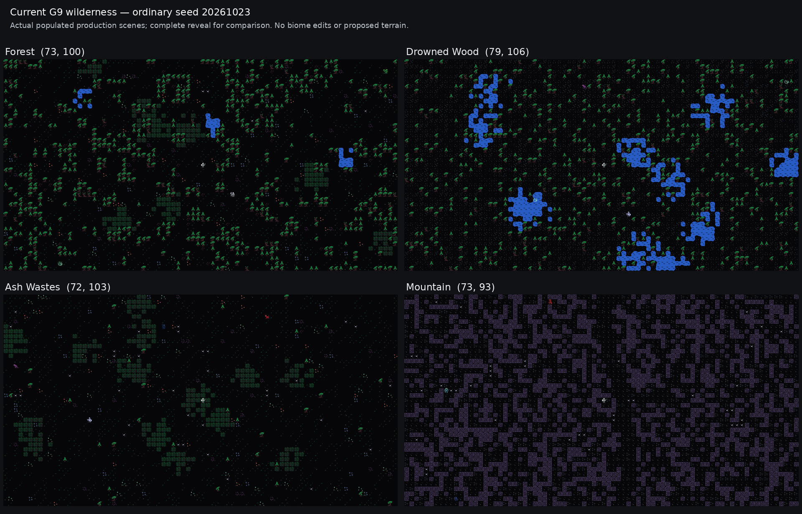

# G9 review and the next development decision

**Prepared:** 24 October 2026, America/Edmonton.  
**Reviewed main:** `f9fe901417b360bc1fda84835e0a793eaac2f6df`.  
**Verified G9 tag:** `checkpoint/worldgen-g9-verified-20261024-a`.  
**Frozen game/test input commit:** `919e8b40ab5ebca6cf5df6ae3afaf6baa4b67d78`.

## Decision

**Close G9's bounded country-road task and make G10 “Wilderness character and playable exploration.”** The delivered source and retained results substantiate G9's main claims. Further road optimization is not the highest-value next task. The current terrain presents a clearer opportunity to improve the appearance, setting and experience of the connected world.

The owner's clarification governs this decision: the objective is a fun, playable, believable-looking post-apocalyptic open world fitting Resonance. Roads are supporting infrastructure. Their value is helping the player move between meaningful places and make useful choices; an increasingly efficient transport network is not an independent project objective.

The owner also explicitly changed the documentation policy. **Wiki upkeep belongs to separately commissioned targeted briefs.** The next implementation brief removes the older automatic wiki obligation from `AGENTS.md`, leaves the current edition intact and requires only a concise feature guide and completion report. G9's wiki corrections remain completed work under the earlier brief; they do not become recurring release requirements.

The complete implementable instructions are in `CODEX_G10_WILDERNESS_CHARACTER.md`.

## 1. Source and report agree

The existing clean review checkout was fast-forwarded from the previously reviewed G8 source to current remote main. Its HEAD and the verified G9 tag both identify `f9fe901417b360bc1fda84835e0a793eaac2f6df`. No implementation change, commit, wiki edit or publication was made during this review.

The attached `Pasted text(7).txt` is byte-identical to the in-repo [`WORLDGEN_G9.md`](https://github.com/dgobi/ResonanceRoguelike/blob/f9fe901417b360bc1fda84835e0a793eaac2f6df/docs/owner/WORLDGEN_G9.md): 19,778 bytes, SHA-256 `d09b5e47e1a38d0b78a08aa738c56fefb5fdc9d1bdadeea7fd4febd599699aac`.

The source history separates the wiki correction, network implementation, lifecycle tests, authoring/journey work, catalog repair, frozen inputs and final documentation. The first release attempt stopped at a stale derived catalog. Final-b reran the whole ten-gate sequence after that repair. Earlier passing receipts are not substituted for the final run. [Frozen release](https://github.com/dgobi/ResonanceRoguelike/blob/f9fe901417b360bc1fda84835e0a793eaac2f6df/evidence/worldgen-g9/final-b/release.json).

### What the prior G9 brief required and what landed

| Requirement | Delivered state | Review judgment |
|---|---|---|
| At most two optional connections, with a shared 25% added-length cap | The required ordinary seed adds one connection and 5,265 unique edges to a 24,631-edge baseline, or 21.38%. | Meets the bounded construction goal. |
| At least 50% improvement for the named ordinary pair | `settlement-1` to `capital-gateway` falls from 23,625 to 8,063 physical steps: 65.87%. | Meets the required travel benefit. |
| Preserve the complete G8 baseline | All three baseline plans recover exactly, including destinations, routes, crossings, selected structures, settlement composition and rural ownership. | Substantive preservation, not merely equal counts. |
| Legal usable new geometry | No new physical bridge cells; 15,786 added full-width road cells; all 86 touched scenes materialized and checked. | Supported by retained evidence and fresh G9 tests. |
| Honest optional outcomes | Seeds 0 and 29417 add no qualifying connection within the declared finite policy. | Valid zero results; not evidence that every possible candidate was searched. |
| Safe historical/current lifecycle | Genuine G8 visited/pending fixture, current-policy independence, sixteen checksum-consistent corruption negatives and late-failure recovery. | Meaningful coverage of the saved-world contract. |
| Useful owner workflow | Complete installed policy, safe preview/draft/install/recovery documentation and five G9 workflows. | The feature is operable beyond the generator module. |
| Portable wiki correction | Canonical text freshness, raw provenance, exact downloadable payload identities, helper binding and checkout-stable HTML. | Retained checks support completion of the earlier commissioned scope. No ongoing G10 obligation follows. |

These findings are supported by the [completion matrix](https://github.com/dgobi/ResonanceRoguelike/blob/f9fe901417b360bc1fda84835e0a793eaac2f6df/evidence/worldgen-g9/index.json), [diagnostic](https://github.com/dgobi/ResonanceRoguelike/blob/f9fe901417b360bc1fda84835e0a793eaac2f6df/evidence/worldgen-g9/final-b/diagnostic/results/run.json), current code and independent audit scripts in this package.

The accepted connection joins `settlement-1` and `settlement-3`, rather than directly joining the capital. It still improves the required capital journey and satisfies the brief. The earlier review's shorter in-memory candidate was a feasibility witness, not a mandatory exact path. Chasing that last distance improvement would reopen a completed objective without establishing a better exploration experience.

## 2. Independent evidence checks

The review performed data-only reconstruction and hashing independently of the runtime's own validators:

- All **726 frozen input paths** at current HEAD match the frozen Git blobs. Of the Windows-tested representations, 451 match exactly and 275 reconstruct through uniform newline conversion. There are no semantic discrepancies.
- All **ten final-b receipt hashes** match, bind the same inputs, report exit zero and stable source, and record no timeout.
- All **1,076 retained gate-output entries** match byte-for-byte. The 2,163 absent entries are exclusively disposable save payloads; every missing path, size and hash reconciles with the omission index.
- The genuine G8 checkpoint has nine archive members. Its CRCs, member sizes/hashes, checkpoint manifest and compressed plan agree. It is genuinely format 6 / `wg8`, created by the previously reviewed G8 source.
- All **57 primary-pair full-width physical distances** across the three ordinary plans were recomputed without importing game code. They match the report and none increase. The complete G8 baseline records, added unique centerline length and zero new bridge-deck cells also reconcile.

See `evidence/evidence-audit/FINDINGS.md`, `audit.json` and `geometry.json` for the exact procedures and counts.

### Retained release results versus fresh review execution

| Verification | Source of result | Result |
|---|---|---|
| Full focused suite | Retained final-b Windows release | 229 tests passed. |
| Browser editor consumers | Retained final-b release | 42 checks and 129 codec documents per engine; Chromium and Firefox passed. |
| Full production gate | Retained final-b release | 3,675/3,675 checks, 159 workers, 74 coverage groups, seven runner negative controls. |
| G9 network and lifecycle modules | Fresh Linux review execution | 13 tests passed in 136.224 seconds; exit zero, no timeout. |
| Ordinary G9 diagnostic and real-handler journey | Fresh Linux review execution | Passed in 374.995 seconds; all three ordinary plans, 86 shortcut-touched scenes and the 107,749-input explored-checkpoint journey verified. |

The fresh G9 test execution preserved all **6,302 tracked files** and left the checkout clean. It covers ordinary preservation, every shortcut-touched scene, controlled network/budget cases, historical restore, saved-policy independence, corruption rejection and rollback. The review did not rerun the entire 229-test suite or full production gate; those broader outcomes are explicitly retained-release results.

The fresh diagnostic also passed with no source changes. All three complete plans equal the retained release plans, including their resolved decisions; their serialized files differ only in LF/CRLF representation. All 86 shortcut-scene fingerprints and all explored-checkpoint surface fingerprints match the retained run. Planning remains lazy with zero materialized scenes at completion. The journey crossed 1,695 boundaries, reached eight recorded destinations and restored the actual 470-scene explored checkpoint. Its fixture controls remain the same paused-AI/survival engineering controls discussed below.

The Linux review checkpoint was 254,085,875 bytes, with save/cold-load/F9 measurements of 1.880/5.893/5.871 seconds. These are separate machine/runtime observations, not evidence of improvement over the Windows release timings. Python 3.12.14, pygame 2.6.1, tcod 19.3.0 and numpy 2.3.5 were used. Exact receipts and comparisons are in `evidence/review-summary.json` and `evidence/diagnostic/`.

The separate original G9 portable ZIP and its adjacent publication receipt were not attached or retained as that finished archive in the repo. This review therefore does not certify that archive's exact member inventory. The report and index explicitly condition that part of delivery on external attestations. Current remote source/tag identity and retained in-repo evidence can be verified independently, and no runtime blocker was found from this limitation.

## 3. What G9 proves about play, and what remains open

G9 has meaningful traversal evidence: actual movement, doors, interactions, boundaries, the accepted route in both directions, a surviving original corridor, the fixed destination pair, inherited town/compound content and explored-checkpoint restoration. The reported expanded journey uses 107,749 movement inputs and retains 470 checkpoint scenes. Physical four-neighbour distance and movement-input counts are kept separate where they differ. [Journey scope and costs](https://github.com/dgobi/ResonanceRoguelike/blob/f9fe901417b360bc1fda84835e0a793eaac2f6df/docs/owner/WORLDGEN_G9.md).

It is also an explicitly controlled engineering journey: native actors are retained as stationary obstacles, AI and survival updates are paused, and invincibility is enabled. That is useful evidence for traversal and state. It does not establish the pacing, danger, resource use or appeal of an ordinary expedition.

This is not a finding that the game is unplayable. It identifies the next useful kind of evidence. G10 should include a short outing with normal visibility, active AI/survival and ordinary supplies, using an existing resource or interaction and reaching a useful stop or return point. A few chunks can demonstrate that better than another very long protected coverage route. One successful outing remains a bounded playability result, not a proof of overall fun or whole-game balance.

## 4. The terrain is the clearest next opportunity

Current wilderness uses small local cluster passes over largely independent tile draws. Forests draw trees at 35% before cleanup, open plains at 6%, and mountains draw rock at 45%. Drowned Wood starts as mud with 20% trees and receives local water clusters. Ash Wastes starts from varied grass with 1% trees and also receives fourteen generic tall-grass clusters. These are source rules, not measured final densities after dressing or infrastructure. [Current region generator](https://github.com/dgobi/ResonanceRoguelike/blob/f9fe901417b360bc1fda84835e0a793eaac2f6df/roguelike/generation/region_gen.py).

The review materialized four complete native scenes from ordinary seed `20261023`, selected near the starting location with their real biome assignments. None was given a forced biome, new terrain or new asset. The production renderer was used with explicitly revealed visibility for comparison.

| Ordinary scene | Observed current content | Implication |
|---|---|---|
| Forest `(73,100)` | 707 trees, 2,516 grass, 133 tall grass and 25 shallow-water cells. | Useful assets exist; broader stands and clearings could make movement and cover more legible. |
| Drowned Wood `(79,106)` | 676 trees, 2,490 mud and 267 shallow-water cells. | Trees and wet ground exist, but their arrangement can better convey a drowned landscape. |
| Ash Wastes `(72,103)` | 3,368 of 3,440 cells are grass/tall grass, plus 36 trees and 125 harvestable plant decor entries. | A direct mismatch with its existing barren, stone-dominated description. |
| Mountain `(73,93)` | 1,502 rock and 1,899 gravel cells, plus 39 flint. | The production view exposes pronounced tile-scale rock/gravel scatter; coherent masses and gaps would be more readable. |

Exact scene seeds, hashes, fingerprints, actors, provenance and resource counts are in `evidence/gameplay-direction/views/baseline-views.json`. These are four concrete scenes, not population-wide aesthetic statistics.

The Ash Wastes issue is functional as well as visual. `varied_grass` can resolve into harvestable flowers or mushrooms through `LocalMap.set_tile()`. A terrain pass must consider resources, visibility and movement cost; it cannot safely be treated as recoloring. [Tile/decor behavior](https://github.com/dgobi/ResonanceRoguelike/blob/f9fe901417b360bc1fda84835e0a793eaac2f6df/roguelike/world/local_map.py), [existing Ash Wastes setting](https://github.com/dgobi/ResonanceRoguelike/blob/f9fe901417b360bc1fda84835e0a793eaac2f6df/roguelike/data/biomes/ash_wastes.json).

The original proposal recommended shared world-coordinate environmental fields and a distinction between natural transitions and accidental chunk borders. That work remains useful after G9. The current macro biome labels also change frequently between adjacent chunks; the small probe measured about 68.3–68.6% different labels among cardinal wilderness-neighbor pairs in three worlds. This measures label churn, not the percentage of visually defective boundaries. G10 should improve local fields and transitions while preserving that coarse geography, rather than expand into a climate and hydrology rewrite.

## 5. Recommended G10 design

Use one bounded terrain method and a small set of profiles for the eight existing wilderness biome IDs. Compose natural shapes in absolute tile coordinates, then apply existing authoritative infrastructure and authored content. Read a bounded halo of saved neighboring metadata without materializing those neighbors.

The visible goals are straightforward: forest stands and clearings; open plains/heath with broad vegetation patches; wetland pools with firmer routes; barren Ash Wastes; and rock masses with navigable mountain gaps. Use existing tiles and lore. Forests can remain lush while the wastes honor their own description. Preserve VUKH, the start, capital, rivers, towns, compounds, buildings and all resolved road geometry.

The brief includes three safeguards that matter to implementation:

1. **Explicit terrain ownership and compatibility.** New worlds save the terrain algorithm/profile contract needed for pending generation. Historical worlds retain the old terrain route. Missing required data in a new-policy save must reject rather than silently select legacy behavior.
2. **Separate terrain randomness.** A global `wg9` to `wg10` seed change would also reroll actors, loot, entrances and underground scenes. The new terrain domain must stay separate from the ordinary map context and unrelated generation streams.
3. **Original ownership controls eligibility.** The current planned-scene code temporarily turns a copied town base into `PLAINS`. The wilderness pass must check the original scene ownership so it does not accidentally alter town backgrounds. Fresh submap entrances may find a different legal location in changed ground, while their chunk/identity/link contracts and all previously saved entrances remain intact.

These are narrow integration requirements, not a request to redesign the engine. The preferred approach keeps the format-7 country plan unchanged and saves the surface policy separately. [Generation context](https://github.com/dgobi/ResonanceRoguelike/blob/f9fe901417b360bc1fda84835e0a793eaac2f6df/roguelike/generation/context.py), [planned scene](https://github.com/dgobi/ResonanceRoguelike/blob/f9fe901417b360bc1fda84835e0a793eaac2f6df/roguelike/generation/planned_scene.py).

The accompanying brief asks for one safe preview/tuning route, production before/after views, same-coordinate field continuity checks, preserved access, genuine historical save checks and the short live outing. Final focused and production verification remain appropriate. It does not carry forward G9's wiki gate, unchanged browser-editor checks, five authoring campaigns or 107,749-input coverage requirement.

## 6. Why other work waits

| Candidate | Decision now |
|---|---|
| More road optimization or simulated transport efficiency | Stop. G9 satisfies its bounded travel objective; the user has clarified that network efficiency is subordinate to play and setting. |
| Wilderness terrain character | Next. It has concrete current visual/functional problems, existing assets, clear integration points and a bounded playable outcome. |
| Save/load and checkpoint growth | Keep as a specific future performance brief before substantially expanding campaign/world targets. The cost is real but is not a newly demonstrated G9 correctness failure. |
| More POIs, settlement forms, capital content or controlled ruins | Reassess after the terrain/play review. Additional authored places can be valuable, but they do not address the current ground composition. |
| Larger world, continuous viewport, ecology/history simulation | Separate future scope. Current finite geography is sufficient to demonstrate the desired experience. |

G9's retained same-machine seed-20261023 planning rises from 1.732 seconds with preserved G8 settings to 5.953 seconds with G9. Its profile points to exact physical-distance evaluation and validation as larger contributors than macro search. Those are meaningful costs and a further reason not to expand the network machinery casually. The profiler's inclusive values overlap and must not be added as wall time. [Measured cost discussion](https://github.com/dgobi/ResonanceRoguelike/blob/f9fe901417b360bc1fda84835e0a793eaac2f6df/docs/owner/WORLDGEN_G9.md).

The retained expanded checkpoint is about 254 MB, with roughly 12.6-second save and 9.7–9.8-second cold-load/F9 measurements on the implementation machine. It contains more scenes than the prior G8 coverage checkpoint, so the comparison does not establish storage regression or improvement. Surface cache eviction already exists. The accumulated cost comes from complete checkpoint gathering, writing, validation and retained generations; a later storage brief should target those measured paths while preserving atomicity. [Save manager](https://github.com/dgobi/ResonanceRoguelike/blob/f9fe901417b360bc1fda84835e0a793eaac2f6df/roguelike/engine/save_manager.py), [checkpoint publication](https://github.com/dgobi/ResonanceRoguelike/blob/f9fe901417b360bc1fda84835e0a793eaac2f6df/roguelike/engine/checkpoints.py).

G10 should measure its added scene cost and stay lazy, but it should not absorb checkpoint redesign. The resulting terrain views and ordinary outing will provide a better basis for choosing G11. No subsequent arc is automatically authorized.
