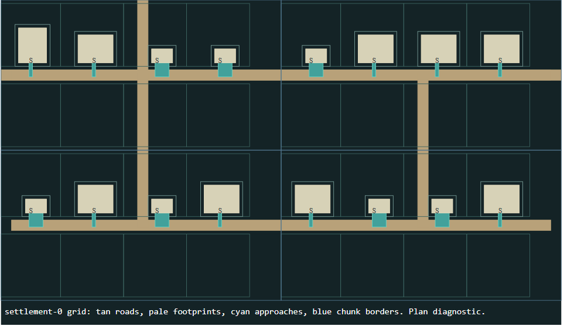
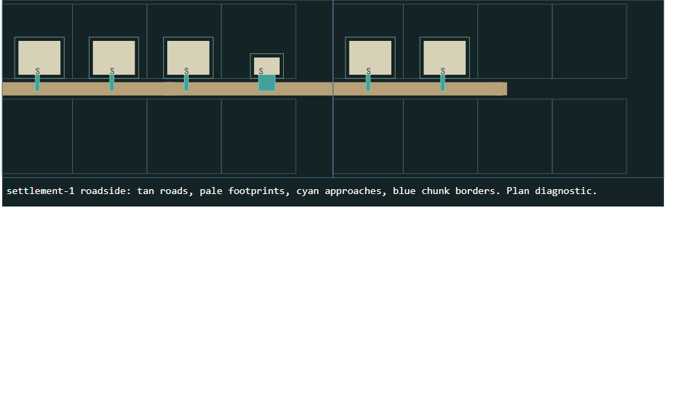

# G3 verification evidence

The completed arc passed the final gates on production `main`, using the frozen
input commit `cbc9c66386f2a36c3ab8971f8d6ab4d0fc089e2d`. The delivery tag is
`checkpoint/worldgen-g3-verified-20261023`. It points to the final documentation
and evidence commit; executable, data, test, editor and executed authoring-guide
inputs are unchanged. The final delivery response records the verified remote
main/tag SHA after the normal push.

See [owner guide](../../docs/owner/WORLDGEN_G3.md) for all 20 acceptance rows,
commands, compatibility rules, checkpoint chain and scope limits. The task input
ZIP and its 29 manifest entries were verified in [provenance.json](provenance.json).

## Final results

| Gate | Observed result |
|---|---|
| Focused discovery | 148 tests, 85.928 seconds, passed |
| Chromium 156.0.8078.4 | 28 checks, passed |
| Firefox 157.0 | 28 checks, passed |
| Browser document coverage | 65 immutable originals and 64 final live documents round-trip in each browser |
| Ordinary seed diagnostic | Seeds `0`, `20261023`, `29417`: all 3 passed, no failed seed omitted |
| Complete movement journey | Seed `20261023`: passed, including F5/F9 coherent rollback |
| Unfiltered production gate | 159 workers; 3,675 / 3,675 checks passed; zero failed |
| Runner negative controls | Zero assertions, missing result, stale run, wrong phase, crash, timeout and false assertion all rejected |
| Catalog and editor freshness | 64 assets, 238 declared legacy warnings, zero errors; freshness passed |
| Exact authoring walkthrough | All eight commands passed; both sentinel-edited drafts survived repeated initialization byte-for-byte |

[final-results.json](final-results.json) retains versions, individual browser
checks, authoring results, journey summary and the declared seed sample.
[full-gate-summary.json](full-gate-summary.json) includes complete case coverage.
The original assertion/worker enumeration remains in the full report. The
historical `UI-TEXT-HEIGHT` lab-text truncation remains an explicitly retained
out-of-scope defect signature, not a newly passing text-layout test.

## Frozen sources and commit reconciliation

All four final reports agree with all **583 raw execution input hashes**.
The browser also reports its **8-file UI subset**, which is not presented as
coverage of every runtime file. All **11,860 worker module-import observations**
reconcile to the frozen source manifest.

At the gate-input commit, 363 files match Git bytes exactly and 220 differ only by
Windows LF/CRLF checkout conversion. There are no code/content differences and no
post-gate changes to a tested input. See
[source-reconciliation.json](source-reconciliation.json), including the full
execution manifest and every newline-only path. Semantic generation dependencies
are distinct from these raw execution hashes.

The first final gate used `9abf702`. Its focused, browser and journey runs passed,
but the production gate found an over-broad reference requirement for synthetic,
unversioned owner maps. That run was interrupted; it is not counted as a pass.
`cbc9c66` narrows the check to explicitly generated G3 surfaces and adds both
positive unversioned-owner and corrupt-G3-reference regressions. All four final
gates were rerun after that correction. Earlier failures and worker results are
retained in the development archive.

## Measured sample and comparison

These are bounded observations on the established Windows/Python 3.11 environment,
not distribution estimates or universal latency promises. G3 planning includes
the legacy macro terrain stage plus shared-plan creation. Plan size is compact
JSON bytes; full saved world/checkpoint sizes use the existing save format.

| Seed | G3 macro + plan | Legacy-path macro | Shared plan bytes | Settlement planning | G3 scene range | Legacy town scene |
|---|---:|---:|---:|---:|---:|---:|
| 0 | 0.599 s | 0.446 s | 527,981 | 0.010–0.023 s | 0.131–0.172 s (12 scenes) | 0.112 s |
| 20261023 | 0.706 s | 0.404 s | 657,128 | 0.010–0.020 s | 0.129–0.208 s (14 scenes) | 0.125 s |
| 29417 | 0.679 s | 0.598 s | 592,452 | 0.010–0.020 s | 0.175–0.315 s (14 scenes) | 0.186 s |

The per-seed comparator deliberately uses the preserved G2-style legacy route in
the current source. It is not a newly checked-out historical G2 build. The actual
historical G2 full-gate report is retained at
[`worldgen-g2/full-gate-results.json.zip`](../worldgen-g2/full-gate-results.json.zip):
its 159 worker process times sum to 372.595 seconds, versus 384.802 seconds here.
These process-time sums include startup and fixtures and are not gameplay latency.
G2 has no matched connected-journey measurement or shared-settlement planning
stage; an invented like-for-like value would be misleading.

The before-correction G2 town checkpoint was 884,133 bytes; the identical map and
actors without its accidental catalog were 526,473 bytes, a 357,660-byte catalog
overhead. The cold-load correction is independently tested. No catalog is retained
in a newly generated scene or in the shared plan.

All three plans finished with **zero local scenes materialized**. The journey
walked **26,989 steps** and asserted **412 exact planned boundary crossings**,
visiting both settlement forms, all eight encountered bridges, an authored
container and the separate landmark. It generated 182 surface scenes before F9.
The worst measured boundary transition was **0.207 seconds**; F5 took **1.025
seconds**, F9 **0.410 seconds**, and the coherent checkpoint occupied **18,818,411
bytes**. F9 restored the earlier plan/world/scenes, removed post-checkpoint
exploration, and travel never advanced checkpoint HEAD.

The journey pauses AI/survival updates and leaves generated creatures as stationary
obstacles. Production movement, door, stair, interaction, destination preparation,
travel and save handlers remain active. Native contents and ownership have
separate tests. This is a traversal/lifecycle test, not combat-balance evidence.

| Seed | Settlements | Placed / vacant plots | Occupancy / frontage coverage | Crossings | Maximum route detour |
|---|---:|---:|---:|---:|---:|
| 0 | 3 | 39 / 42 | 48.15% | 6 | 1.191× |
| 20261023 | 4 | 45 / 52 | 46.39% | 8 | 1.879× |
| 29417 | 4 | 43 / 54 | 44.33% | 13 | 1.157× |

Occupancy counts all plan plots, including the required landmark. Here frontage
coverage is the same occupied-plot fraction, not a separate street-length metric.
Asset repetition is recorded per seed in [seed-results.json](seed-results.json).
The small opted-in library and conservative exclusive approaches leave substantial
vacant garden space; hard traversal validity does not certify visual variety or
the preferred density. No essential destination fell back to an optional garden.

## Evidence layout

- `before-authoring.json`, `before-catalog.json`, `corrections/` and `plans/` retain
  the reproduced defects and earlier tested milestones.
- [final-complete-evidence.zip](final-complete-evidence.zip) retains all 51 final
  focused, browser and diagnostic files plus `full-gate/results.json` and its
  console log. It includes the full journey crossings, complete per-seed plans,
  browser screenshots/downloads and actual production preview JSON/SVG.
- [authoring-previews.zip](authoring-previews.zip) retains all 37 walkthrough
  outputs: all eight orientations, grid/roadside materialization, landmark and
  world plan. Logs and [authoring-sentinel.json](authoring-sentinel.json) remain
  directly readable. The earlier unselected landmark outcomes are retained;
  seed 29417 is the documented positive with the existing candidate retained.
- [development-and-interrupted-gate.zip](development-and-interrupted-gate.zip)
  retains 337 development and interrupted-gate files, including the first final
  reports and available failed-worker JSON. It is historical evidence only.
- Each archive has a neighboring manifest with member byte counts/SHA-256 and
  archive SHA-256. Every compressed member was read back and verified. No campaign
  save roots, virtual environments or alternate development checkouts are bundled.
- [journey-summary.json](journey-summary.json), [catalog-summary.json](catalog-summary.json)
  and [disposable-startup.txt](disposable-startup.txt) are compact entry points.

Expanded generated report directories were moved to ignored review storage only
after archive verification; the committed archives preserve their exact contents.
Running the documented commands recreates their ordinary evidence directories.

## Small diagnostic views

These are diagnostic drawings from real production plan/materialization outputs,
not played-game screenshots. Tan shows roads, cyan shows approaches, pale boxes
show footprint reservations, and blue shows storage chunk boundaries. Inspect
the SVG versions for plot, frontage and normal labels.

[Grid SVG](grid-plan-detail.svg) · [Roadside SVG](roadside-plan-detail.svg)

The [grid](frontage-grid-0.png) and [roadside](frontage-roadside-0.png) local
materialization previews complement these whole-settlement views. Complete
scene content and exact reservations remain in the JSON, not in pixel colors.
