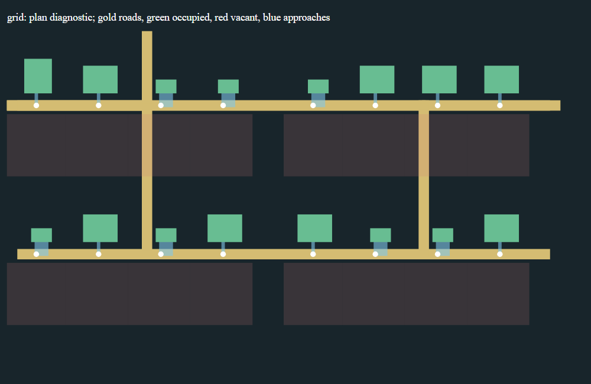
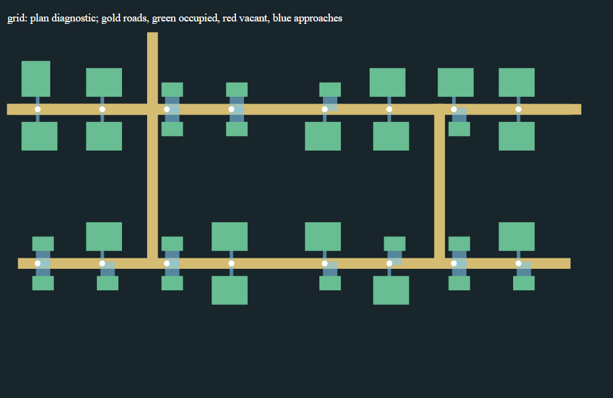
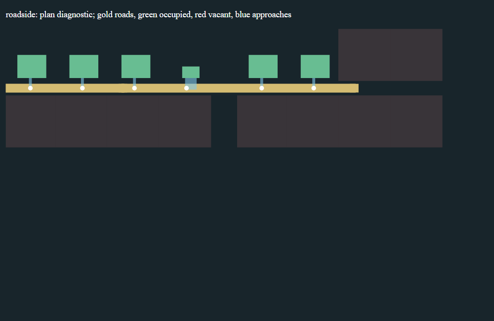
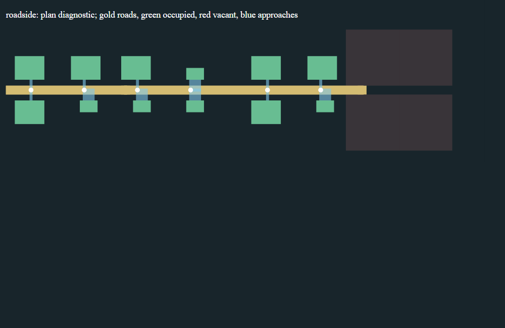
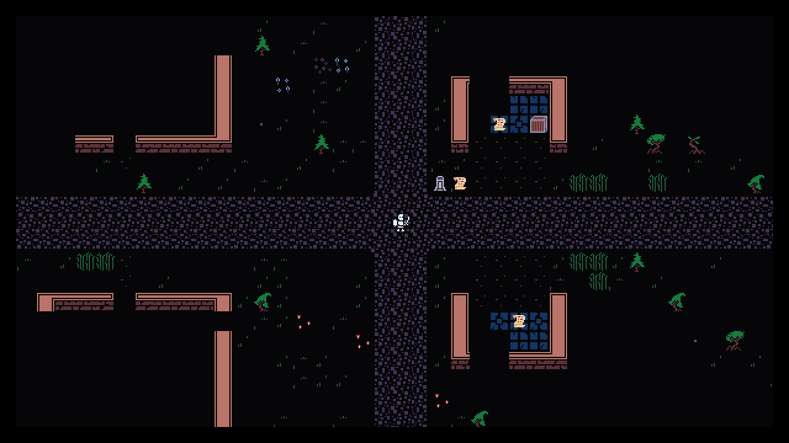

# G4 verification evidence

This arc began on clean production `main` at `b772981`. All 38 manifest entries
in the attached brief were verified. [input-provenance.json](input-provenance.json)
records its hash, exact before-probe commands, interpreter and dependency versions.
The dependency environment was reused unchanged: Python 3.11.0, pygame 2.6.1,
tcod 19.3.0, numpy 2.4.6 on Windows.

The complete [owner report](../../docs/owner/WORLDGEN_G4.md) maps all 20 acceptance
rows to actual tests and explains authoring, ownership and G3 compatibility.
`final-results.json` and `source-reconciliation.json` bind the final reports to
the second frozen input commit `2fe0372327b1c3343c40fe92ce0d475d00555939`.
The delivery tag is `checkpoint/worldgen-g4-verified-20261023`; the final response
records its verified remote commit after the normal main/tag push.

## Final results

| Gate | Result |
|---|---|
| Focused | 163 tests in 223.622 seconds; all pass. |
| Chromium 156.0.8078.4 / Firefox 157.0 | 30 checks each; 129 codec documents each, plus real edit/download/runtime checks. |
| Authoring | 12 commands succeed; two edited drafts preserved across repeated initialization. |
| Catalog | 64 assets, zero errors, 238 retained legacy warnings; editor catalog fresh. |
| Ordinary worlds and journey | Seeds 0, 20261023 and 29417 all pass; 27,001 journey steps and 412 exact boundaries. |
| Unfiltered production | 3,675/3,675 checks, 159 workers, seven runner negative controls. |

All five source-bearing reports agree on 592 execution inputs. Reconciliation
checks 12,125 recorded worker-module imports; 372 input files match Git bytes
exactly and 220 differ only by line endings. The post-gate delivery changes only
the owner report and evidence. No tested input changed.

The final archive holds 127 members / 68,961,963 uncompressed bytes in 4,066,099
bytes. The separate development/first-gate archive holds 250 members / 130,585,326
uncompressed bytes in 7,423,354 bytes. Every member is verified against the nearby
inventory. See [final-results.json](final-results.json),
[seed-results.json](seed-results.json), [journey-summary.json](journey-summary.json)
and [source-reconciliation.json](source-reconciliation.json).

## Before and after

The original three probes ran before repairs and retained their failure
observations in [before/composition.json](before/composition.json),
[before/frontage.json](before/frontage.json) and
[before/persistence.json](before/persistence.json). They are failure reproducers,
not unchanged tests counted as final successes. Final positive regressions live
in normal focused discovery.

Seed 20261023 originally had zero native actors in all 12 planned town members,
stale wilderness zones, no starting waystone and no clay at the measured crossing.
Current scene checks inspect every planned member across all three ordinary seeds.
Actual waystone/prayer/gather handlers, native AI turns, edge travel, cold load and
F9 are tested separately from the controlled long-distance topology journey.

Across seeds 0/20261023/29417, north-facing occupancy rose from 0/136 to 124/136.
South-facing occupancy stayed 124/136. The remaining vacancies have explicit fit
reasons. This is a bounded comparison, not an imposed equal-density target.
`plot_occupancy` counts occupied/all proposed plots, including the landmark.
The old duplicate `frontage_coverage` is deprecated. Candidate tables explicitly
distinguish eligible transformations from attempted transformations; trials stop
at first success, and zero categories are retained.

Per-edge detour ratios measure individual polylines relative to endpoint Manhattan
distance. They do not establish whole-network shortest travel. Network-quality
and visual-variety work remain later scope.

These paired diagnostics show the same representative grid and roadside streets
before and after the repair. PNGs are headless renders of the neighboring SVGs;
the SVG versions retain hover explanations for rejected slots.

| Form | G3 before | G4 after |
|---|---|---|
| Grid |  |  |
| Roadside |  |  |

The separate image below uses the production game renderer during the native-turn
fixture, including the actual visibility rules and restored scene content.

## Retained unsuccessful/development attempts

- The first interaction test could not render without an SDL video mode. The
  offscreen fixture now creates a dummy mode before loading production sprites.
- The next interaction test exposed serialization of an intentionally absent town
  waystone position. The serializer now preserves `None`, and the complete
  interaction/travel/cold/F9 case passes.
- An early direct bridge fixture omitted the newly required plan-origin header.
  The synthetic fixture now declares its G3 plan version/origin explicitly.
- The development diagnostic completed all declared seeds and the extended journey,
  but its source-stability flag is false because implementation changed during
  that development run. It is not the accepted frozen run.
- Frozen input `d46e108` passed browser, authoring and diagnostic/journey checks.
  Focused discovery exceeded its old 180-second limit under concurrent test load.
  That attempt has a timeout console, not a fabricated completed test count. The
  expanded runner now has a 300-second bound and retains partial output on timeout.
- The first unfiltered gate ran all 159 workers and recorded 3,670/3,673 checks;
  one processing fixture failed, producing two additional harness failures. It
  replaced a generated surface with a generic owner map but retained the generated
  Chunk claim. The fixture now explicitly clears that obsolete claim. Production
  marker-removal rejection stays intact. The corrected targeted case passed 17
  checks. All final suites were rerun after corrective commit `2fe0372`.
- A reporting-only SVG screenshot attempt timed out while loading the standalone
  SVG document. Embedding the same SVG bytes in a plain page rendered all four
  previews successfully. Both console logs and the source hashes are retained;
  this did not change or rerun any game input.

The complete unsuccessful run and available development logs remain in
`development-and-first-gate.zip`, with a verified member inventory. No failed
seed was discarded and no partial production gate is represented as completion.

## Archive and provenance layout

- `final-complete-evidence.zip` contains full focused output, both browser records,
  real downloaded JSON, production preview JSON/SVG, all declared plan/scene and
  journey results, executed authoring command records and the unfiltered production
  worker/assertion report. All runner negative controls remain in that report.
- Neighboring manifests include every member's byte count/SHA-256 and the archive
  SHA-256. Every member is read back and verified before raw review output is moved
  into ignored `.baseline` review storage. No campaign save roots, environments,
  browsers or source archives are bundled.
- Captured console logs retain their original trailing spaces and terminal blank
  lines. Documentation and structured evidence pass the normal whitespace check;
  those three raw console files are excluded from that formatting-only check.
- `final-results.json`, `seed-results.json`, `journey-summary.json`,
  `full-gate-summary.json` and `source-reconciliation.json` are compact entry points.
  Reconciliation distinguishes exact Git bytes from LF/CRLF conversion and verifies
  every report's execution manifest plus all recorded worker module imports.
- `grid-plan.svg` / `grid-before-plan.svg` and the roadside pair are small plan
  diagnostics. Gold marks roads, green occupied footprints, blue approaches and red
  vacant plots; hover for rejection explanations. SVGs are not game screenshots.
- `g4-native-production.png` is a real production-renderer capture on an SDL dummy
  surface during the short native-turn fixture. It is not desktop/input evidence.

The long journey retains stationary native actors, pauses AI/survival updates and
uses invincibility; real movement, doors, stairs, interactions and saves remain
active. It reaches the landmark entrance and required target, not merely the road
join. The separate native fixture enables ordinary AI/survival updates. Neither
test certifies balance. The inherited `UI-TEXT-HEIGHT` limitation remains deferred.
