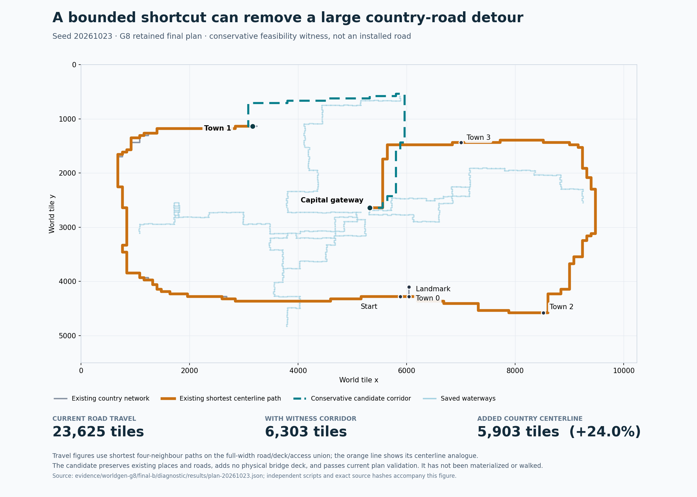

# G8 review and recommended G9 course

**Project:** Resonance Roguelike.  
**Reviewed:** 24 October 2026, America/Edmonton.  
**Repository:** [dgobi/ResonanceRoguelike](https://github.com/dgobi/ResonanceRoguelike).  
**Reviewed main:** `b94a0b0db3685f7484632701f0486f3b0b79101e`.  
**Verified tag:** `checkpoint/worldgen-g8-verified-20261024-a`.  
**Final tested inputs:** `14c98afc38c659c9195b11c6b396fb82544ff03b`.

## 1. Decision

**Proceed to G9: budgeted useful country-road shortcuts, beginning with a focused wiki verification correction.** G8 has delivered the intended settlement composition and closed the earlier destructive authoring-output and focused-runner defects. Its runtime, ownership and compatibility evidence supports building on it. The remaining wiki issue concerns portability and evidence/download identity; the wiki itself is now usable, current and maintainable.

The next feature should preserve the complete G8 baseline and add a small number of useful country connections. An independent constrained witness reduces one ordinary world's shortest road-network trip from 23,625 to 6,303 tile steps while preserving all existing places, roads and physical bridges. That is a concrete reason to choose network quality now. It does not justify a wholesale backbone rewrite or bigger world.

The supplied `CODEX_G9_COUNTRY_NETWORK.md` is the execution brief. It defines at most two optional connections, a shared 25% added-unique-length budget, measurable travel benefit, explicit optional failure, new saved-contract compatibility, complete authoring workflows and maintained owner documentation. It also leaves checkpoint compression/retention and continuous rendering for a later decision.

This review changed no tracked source and made no remote writes. The network candidate exists only in disposable in-memory feasibility probes; G9 has not been implemented.

## 2. Comparison with the previously agreed course

The prior G8 brief deliberately put local settlement composition before strategic road optimization. It required two distinct orthogonal layouts, real civic common, occupied frontage on both axes, exact lots/public ownership, format-6 persistence, owner workflows and the repaired wiki. Its stop boundary said to inspect actual towns and travel before deciding whether network quality should follow. It did not preauthorize an automatic G9.

The current repository now supplies the evidence needed for that decision:

| Previous expectation | Current finding |
|---|---|
| Prevent authoring reports/diagrams from replacing inputs | Shared destination checks stage all outputs; independent recipe/child/symlink collision probes reject before mutation. |
| Direct focused test command works without inherited import setup | Fresh unfiltered direct invocation succeeds with no parent `PYTHONPATH`. |
| Repair the tracked wiki's source/authoring/output loop | Separate scopes, pinned reviewed source, repeated clean builds and later docs-only commits are supported. |
| Ship two meaningful grid layouts | `cross-market` and `linked-courts` differ in avenues, transverse link and civic-common arrangement. |
| Address both street axes and certify all four normals | All six ordinary grid towns have horizontal and vertical occupants; controlled examples certify N/S/E/W in both layouts. |
| Preserve country backbone while improving towns | All three retained G8 country-route sets match their G7 baseline exactly. |
| Save resolved layouts and maintain historical worlds | Format 6 / `wg8`, explicit adapters, genuine G7 fixtures, dependency scope and rollback are exercised. |
| Maintain a usable ongoing owner wiki | Current main chapters and edition 1.2 standalone HTML are delivered; repository instructions now require ongoing affected-guide/wiki upkeep. |
| Assess next stage using actual gaps | Severe avoidable country travel detour now has a source-bound, validator-passing feasibility witness. |

Sources: [original G8 brief](https://github.com/dgobi/ResonanceRoguelike/blob/b94a0b0db3685f7484632701f0486f3b0b79101e/evidence/worldgen-g8/before/CODEX_G8_SETTLEMENT_COMPOSITION.md), [completion report](https://github.com/dgobi/ResonanceRoguelike/blob/b94a0b0db3685f7484632701f0486f3b0b79101e/docs/owner/WORLDGEN_G8.md), [evidence index](https://github.com/dgobi/ResonanceRoguelike/blob/b94a0b0db3685f7484632701f0486f3b0b79101e/evidence/worldgen-g8/index.json), [collaboration instructions](https://github.com/dgobi/ResonanceRoguelike/blob/b94a0b0db3685f7484632701f0486f3b0b79101e/AGENTS.md).

## 3. Report identity and evidence quality

The uploaded `Pasted text(6).txt` is byte-identical to committed `docs/owner/WORLDGEN_G8.md`: 13,185 bytes, SHA-256 `03ec0df4de4d64b07bc4f217f16d085a0c96790b85bd056b29ae925fc344e459`. It describes the actual delivered feature and honestly separates earlier development timings, final gates, ordinary samples and controlled renderer examples.

Independent audit of retained final-b evidence found:

- All **704 frozen input paths** at delivered HEAD match the tested Git blobs exactly. The original Windows representations reconcile as 441 exact and 263 newline-only, with zero substantive discrepancies.
- All **ten final-b gates** bind the same frozen input commit, exit zero without timeout and record stable/reconciled source. The first final attempt's diagnostic syntax failure is retained; final-b reran the complete sequence.
- **1,022 retained output entries** reconcile with their recorded hashes: 444 exact and 578 after uniform newline reconstruction. All **2,163 absent output entries** are disposable save payloads, consistent with the declared omissions.
- Retained focused discovery reports **216 tests, all passing** on Windows. Browser records show **42 checks in each engine**, with 129 codec documents. The unfiltered production record reports **3,675 passing checks, 159 workers, 74 coverage groups and seven runner negative controls**.
- The authentic G7 compatibility archive's eight members pass CRC and checkpoint/witness size/hash checks. It is an actual format-5 / `wg7` witness created by the G7 source, not relabelled G8 output.

The separate portable G8 delivery ZIP/publication receipt was not present in the repository or supplied attachments. This review therefore verifies the retained repository evidence and remote revision, not that unavailable archive's exact member inventory. The G8 report's delivery-archive claim remains separate from the successfully verified code/gate claims.

The wiki has a separate identity rather than belonging to the 704 runtime/test inputs. Its 46 listed authoring files reconcile as 22 exact, 23 uniform CRLF and one mixed-newline representation. No semantic wiki-source mismatch was inferred. The omitted contract-test input and portability problem are detailed below.

See `evidence/evidence-audit/audit.json`, `audit_g8_evidence.py`, `wiki-byte-audit.json` and the associated findings. [Frozen release index](https://github.com/dgobi/ResonanceRoguelike/blob/b94a0b0db3685f7484632701f0486f3b0b79101e/evidence/worldgen-g8/INDEX.md).

## 4. Fresh independent execution

The direct focused command was rerun unchanged from the reviewed source, in a disposable Linux dependency environment, with no inherited `PYTHONPATH`:

```text
python -X utf8 tools/critical_fix_regressions/verify_fixes.py \
  --game roguelike --evidence <disposable-review-root>/focused/results
```

It discovered **216 tests: 215 passed, one skipped, zero errors/failures**. The skip is the documented PowerShell initialization workflow, which requires Windows. The suite took 516.927 seconds; the outer measured command took 520.800 seconds. The earlier G7 renderer import failure is gone. No test was removed or skipped by this review to obtain the result.

The environment was Python 3.12.14, pygame 2.6.1, tcod 19.3.0 and NumPy 2.3.5. This is separate from the established Windows interpreter used for retained final gates, so cross-machine timing differences are not treated as performance regressions. Every one of the 3,843 tracked files remained byte-identical and Git status remained clean after the run.

Five additional authoring CLI probes passed independently: report-to-recipe collision, initializer-report-to-child collision, plan-SVG symlink, dynamic scene-SVG symlink combined with a staged catalogue refresh, and a legitimate distinct-output positive. Invalid invocations preserved every input byte and published no conflicting output; the refresh was not partially performed.

The fresh ordinary-world diagnostic plus real-handler journey also passed, in 180.838 seconds. All three complete generated plans are byte-for-byte identical to retained final-b plans. Each has one connected physical road/access component and zero scenes created during planning.

| Seed | Fresh planning seconds | Slowest sampled scene seconds | Scene samples |
|---|---:|---:|---:|
| 0 | 0.968 | 0.186 | 15 |
| 20261023 | 1.524 | 0.184 | 18 |
| 29417 | 1.294 | 0.207 | 18 |

The fresh journey completed 38,805 movement inputs and 595 boundary transitions, exercising G8 town/common/content and native civic features alongside the bridge, other settlement, landmark, compound children and single site. It used production movement/interactions/travel/save handlers with stationary native actors and paused AI/survival; it is distinct from the focused suite's ordinary-update positives. Its actually explored checkpoint contained 354 scene files and 195,744,120 bytes. Save took 1.523 seconds, cold load 4.137 seconds and F9 4.307 seconds; F9 restored the explored checkpoint. The worst measured transition was 0.273 seconds. These Linux measurements are not substitutes for the separate Windows baseline.

Results are recorded in `evidence/diagnostic/` and summarized in `evidence/review-summary.json`. All 3,843 tracked files remained unchanged after both fresh runs. Remote main and the verified G8 tag were read back at the same reviewed commit. The broad Windows browser/production gates were audited as retained records rather than represented as newly executed here.

## 5. What the actual settlements now show

The three ordinary seeds remain `0`, `20261023`, `29417`. Across their eleven towns, G8 proposes 163 lots, occupies 149 and leaves 14 explicit vacancies. There are six grids and five horizontal roadside settlements. Three grids use each installed layout. All six grids have occupants on both street axes, with twelve occupied vertical frontages across the sample. Each grid has a 361-tile civic common.

| Ordinary sample measure | G7 | G8 |
|---|---:|---:|
| Towns | 11 | 11 |
| Proposed town lots | 272 | 163 |
| Occupied town lots | 233 | 149 |
| Explicit vacant lots | 39 | 14 |
| Occupied east/west frontages | 0 | 12 |
| Distinct shipped grid arrangements represented | 1 | 2 |
| Planned civic commons | 0 | 6 |

These are descriptive results from the declared sample, not frequency estimates or targets to maximize. Fewer buildings do not imply a placement regression: G8 explicitly allocates public common and disjoint private space, derives finite frontage intervals from actual road geometry, and retains deliberate garden blocks. The lower plan sizes are consistent with fewer resolved lots/buildings offsetting the added block/common metadata.

| Seed | G8 compact plan bytes | Towns | Additional rural parents | Scene samples | Scenes created during planning |
|---|---:|---:|---:|---:|---:|
| 0 | 598,641 | 3 | 2 | 15 | 0 |
| 20261023 | 709,155 | 4 | 3 | 18 | 0 |
| 29417 | 659,676 | 4 | 3 | 18 | 0 |

I inspected all three complete populated production mosaics. Cross-market has a recognizable rectangular circuit and a northern common beside the bell. Linked-courts moves the avenues, adds a transverse connection and places the common to the south. East/west-facing buildings genuinely address vertical streets. The roadside example faces the actual horizontal country route. The views have deliberately revealed visibility; the controlled grid selection emphasizes residential/commercial content and demonstrates all four normals. It is not an ordinary distribution sample.

The visual limitations are clear and consistent with the bounded brief: repeated asset families, generous empty ground, narrow garden strips and a large simple paved common. These do not require another settlement rewrite before tackling the measured country detour. Ordinary required-door distances from saved arrivals remain finite and validated; the sample's grid civic trips span 55–130 four-neighbour steps.

Sources: [layout implementation](https://github.com/dgobi/ResonanceRoguelike/blob/b94a0b0db3685f7484632701f0486f3b0b79101e/roguelike/generation/settlement_layout.py), [final diagnostic](https://github.com/dgobi/ResonanceRoguelike/blob/b94a0b0db3685f7484632701f0486f3b0b79101e/evidence/worldgen-g8/final-b/diagnostic/results/run.json), [production view records](https://github.com/dgobi/ResonanceRoguelike/blob/b94a0b0db3685f7484632701f0486f3b0b79101e/evidence/worldgen-g8/final-b/visuals/results/views.json), `evidence/retained-metrics-summary.json`.

## 6. Remaining correction: portable and complete wiki verification

The wiki is materially improved. Edition 1.2 contains current main chapters for compounds, settlement layouts, saved-world behavior and safe authoring. Its 5,282,014-byte standalone HTML exactly matches the recorded output hash. Source revision, wiki authoring and generated product identities are separate; the old HEAD/self-manifest deadlock is resolved.

A maintenance-only copy was rebuilt against the unchanged game source. Build, integrity and drift checks passed; a second build produced byte-identical HTML/manifest/report, followed by another passing drift check. The three existing synthetic contract tests passed. Static integrity reported zero errors across 56 source documents, 351 game JSON definitions, 19 total examples, 370 catalogue records, 463 search records and 540 internal links. This was a fresh static/build check; the reader-browser receipts remain retained Windows evidence.

### The portability defect

The shipped binding's documented `--check-drift` command rejects the unchanged LF checkout with exit 2: `stale source build binding; review source and rebuild`. All 761 source-scope files canonically match the pinned source; 291 differ from the original capture only in raw byte count/hash. `wiki_inputs.py` first accepts newline equivalence and then compares complete raw-identity dictionaries. That makes an equivalent checkout appear stale.

Rebuilding succeeds immediately without changing the reviewed source revision, so this is a narrower problem than the former unusable maintenance workflow. The repair should compare semantic text identities consistently while retaining raw capture as provenance and binary bytes exactly.

### Two related binding details

First, `verify_edition.py` runs `test_wiki_inputs.py`, but that test is missing from both the wiki authoring identity and unified runtime input set. The test itself passes; the gap is that a changed verification script would not invalidate the declared wiki input binding.

Second, the catalogue advertises raw source byte sizes/hashes but downloads normalized embedded text. A concrete shipped `deep_tongue.json` record advertises 102,885 bytes while its equivalent downloadable UTF-8 text is 98,460 bytes. JSON values are equal. This was reconstructed from the delivered HTML and reader implementation, not claimed as a newly performed browser download.

The next brief therefore requires one consistent raw/canonical/download policy, all project-owned transitive wiki verification inputs, explicit downloadable-payload identities, small newline/binary/substantive-change fixtures, and real downloads in both established browsers. It preserves stale-output and changed-source failures, repeated builds and later docs-only delivery commits. No bulk owner-source normalization or wiki architecture replacement is needed.

Sources: [wiki input model](https://github.com/dgobi/ResonanceRoguelike/blob/b94a0b0db3685f7484632701f0486f3b0b79101e/Resonance_Wiki_Maintenance/wiki_inputs.py), [builder](https://github.com/dgobi/ResonanceRoguelike/blob/b94a0b0db3685f7484632701f0486f3b0b79101e/Resonance_Wiki_Maintenance/build_wiki.py), [reader](https://github.com/dgobi/ResonanceRoguelike/blob/b94a0b0db3685f7484632701f0486f3b0b79101e/Resonance_Wiki_Maintenance/reader.js), [edition verification](https://github.com/dgobi/ResonanceRoguelike/blob/b94a0b0db3685f7484632701f0486f3b0b79101e/Resonance_Wiki_Maintenance/verify_edition.py), `evidence/wiki-authoring/`.

## 7. Why the country network is now the strongest next feature

The current builder connects a mostly sequential destination list and rewards reuse of previously used macro-road chunks. That produces a connected required network. It does not optimize the resulting travel between all destinations. Good individual route detour ratios therefore do not guarantee good end-to-end journeys.

The independent graph analysis unions cardinal unit centerline edges, merges intersections/retracing, and uses the same terminal set: start, each town, capital gateway and featured landmark. It excludes crossing-bank nodes and additional rural parents from this specific all-pairs table.

| Seed | Unique country length | Summed route-record length | Country cycle rank | Cut-edge share of country length | Worst centerline / Manhattan ratio |
|---|---:|---:|---:|---:|---:|
| 0 | 11,900 | 17,257 | 0 | 100.0% | 1.950 |
| 20261023 | 24,631 | 39,616 | 5 | 94.0% | 6.450 |
| 29417 | 11,833 | 20,908 | 2 | 95.8% | 2.885 |

Overlapping route length can represent useful corridor reuse, not wasted construction. Existing country cycles must not be described as absent. A cut edge is a graph property, distinct from a river bridge; these metrics also do not represent all off-road movement available to a player.

Manhattan distance ignores terrain and establishes only a lower bound. To test whether the severe detour is avoidable, a conservative independent search reproduced each exact saved G8 plan and sought a legal macro corridor without creating scenes or campaigns. It preserved hard terrain exclusions; forbade new river crossings; permitted only existing road edges through settlement, rural, building and capital owner chunks; excluded new chunks containing submaps; and used actual 80/43-tile axis lengths.

For ordinary seed `20261023`, settlement-1 to capital gateway:

| Measure | Result |
|---|---:|
| Current shortest full-width road/deck/access path | 23,625 steps |
| Path after the in-memory witness addition | 6,303 steps |
| Reduction | 17,322 steps / 73.32% |
| Added unique centerline | 5,903 tiles |
| Reused centerline on the candidate | 406 tiles |
| Added centerline / baseline | 23.97% |
| Added width-three road cells | 17,691 |
| Added cells in protected place/private/approach/common rectangles | 0 |
| Added physical bridge-deck cells | 0 |
| Current unmodified normal plan validator | Pass |

Every original route, crossing and reservation record is preserved; other plan subtrees remain unchanged. The candidate is a source-bound feasibility witness, not an installed policy or proof of populated traversal. That remaining gap is expressly included in G9 acceptance.



The orange route is the shortest centerline analogue; the numeric travel labels use the full-width road/deck/access graph. The dashed candidate is uninstalled. Exact coordinates and provenance accompany the figure.

The analogous constrained worst-pair candidates for seeds 0 and 29417 save only 1.35% and 0.88%, while costing 33.9% and 46.9% of baseline unique length. Those candidates should be declined. This is not an exhaustive proof that those worlds have no useful other pair. It supports an optional, benefit-tested policy with honest zero-addition results.

Sources: [country builder](https://github.com/dgobi/ResonanceRoguelike/blob/b94a0b0db3685f7484632701f0486f3b0b79101e/roguelike/generation/world_plan.py), [physical-road projection](https://github.com/dgobi/ResonanceRoguelike/blob/b94a0b0db3685f7484632701f0486f3b0b79101e/roguelike/generation/road_network.py), `evidence/network/country-network-metrics.json`, `macro-corridor-witnesses.json`, `augmentation-replay.json` and their scripts.

## 8. The next brief's important decisions

G9 augments a fully composed baseline. This preserves the places the owner just gained and prevents road optimization from quietly rerolling town positions, assets or rural encounters. The 25% construction cap comes from the 23.97% feasible witness; it is a bounded project choice. The at-least-50% ordinary-seed improvement target leaves margin below the witnessed 73.32% while demanding a visible result.

The brief separates actual travel distance, new unique construction and search score. It requires marginal-benefit recomputation after each accepted shortcut, stable ordering, finite global work budgets and narrow exact geometry checks. It permits existing-deck reuse while forbidding new physical crossings and new road cells in protected owner chunks.

Two source details are particularly important. First, appending a new road reservation after an old private approach can reject valid corridor reuse; replaying new infrastructure before existing private rows preserves the existing narrow permissions. No broad overlap exception is necessary. Second, global connectivity is weaker than the materializer's local requirement: every road tile in a touched chunk must connect within that complete scene. The witness's valid plan still needs populated scene and real-handler proof.

Fresh G9 worlds use format 7 / `wg9` with an explicit resolved network contract. G8 layout/commons and both POI policies remain supported. Several current source paths check `version == 6`; those must be handled deliberately throughout validation, slicing, native furnishing and save preflight. The brief requires genuine pre-edit G8 visited/pending witnesses, old creator provenance, saved-policy independence, corruption negatives and late rollback. Unchanged baseline plan geometry must not be confused with byte-identical new-revision scene randomness.

The owner gets complete safe network preview/tuning/disable/install workflows, source-bound ordinary comparisons and updated main wiki chapters plus compiled offline HTML. Final delivery retains the established clean-environment focused test, both browser engines, inherited authoring consumers, ordinary diagnostic/journey, wiki checks and unfiltered production gate. There are sixteen explicit completion items and a firm stop boundary.

Primary road-generation research supports distinguishing environmental route costs, network/junction structure and final geometry. The particular augmentation policy and thresholds are inferences from this project's evidence, not externally guaranteed algorithms: Galin et al., [*Procedural Generation of Roads* (2010)](https://onlinelibrary.wiley.com/doi/10.1111/j.1467-8659.2009.01612.x) and [*Authoring Hierarchical Road Networks* (2011)](https://onlinelibrary.wiley.com/doi/abs/10.1111/j.1467-8659.2011.02055.x).

## 9. Storage remains a separate measured concern

The final G8 journey reports 38,805 movement inputs and 595 boundary transitions. Its actually explored checkpoint contains 354 scene files totaling 195,744,304 bytes. Final Windows timings are 7.169 seconds to save, 3.907 seconds for cold load and 4.195 seconds for F9. The completion report's slower journey times are explicitly pre-freeze development measurements, so they are not conflicting final claims.

`save_manager.py` assembles and validates complete immutable checkpoints from cold checkpoint, session disk, hot cache and active state. The cost is a real future scaling concern. This review has not found a new save correctness defect or isolated a storage optimization. Combining retention/compression with new road policy would create a broader compatibility/recovery task than necessary.

G9 must continue measuring comparable fixed-endpoint travel and actual explored scene counts/bytes/times. A shorter route may visit fewer chunks; describe that as reduced exploration for an itinerary, not a more efficient storage engine. The following review can choose a dedicated fixed-scene-count storage profile if that becomes the highest-value next step.

Source: [save/cache implementation](https://github.com/dgobi/ResonanceRoguelike/blob/b94a0b0db3685f7484632701f0486f3b0b79101e/roguelike/engine/save_manager.py), [final G8 index](https://github.com/dgobi/ResonanceRoguelike/blob/b94a0b0db3685f7484632701f0486f3b0b79101e/evidence/worldgen-g8/index.json).

## 10. Package contents and scope

Use `CODEX_G9_COUNTRY_NETWORK.md` as the execution instruction. This review explains the decision. The package also contains the exact completion report, previous G8 brief, independent audit/probe scripts and receipts, focused-test evidence, ordinary diagnostic evidence, network map/data and a member manifest.

Disposable campaigns, dependencies, browser profiles, duplicate game source and bulky successful authoring-preview payloads are excluded. Evidence receipts and the package inventory identify the retained scope. The new package is CRC/hash checked; it is distinct from the unavailable G8 delivery ZIP.

No runtime fix, wiki source change, commit or publication was performed as part of this review. G9 begins with the concrete wiki correction and ends after useful bounded country connections, saved-state proof, maintained documentation and verified delivery.
