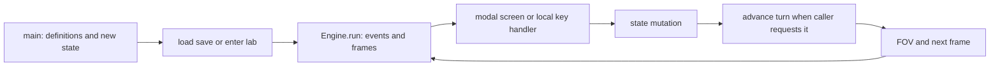

# Runtime map

Purpose: follow one player action from a definition into state, time and presentation. This page describes the reviewed working-copy code; window observations are identified separately in [OBSERVATIONS.md](OBSERVATIONS.md).

## Where execution starts

Workbench's bounded [room-test entry](../ROOM_TEST_RUNTIME.md), `room_test.py`,
validates frozen saved inputs and injects an explicit SaveManager before any
startup/cache probing. It shares normal player construction through
`engine/player_setup.py`, builds a physical foyer and assigned room instance,
enters through production descent and runs the actual Engine loop. F5/F9, quit
and death remain within that disposable session. This path performs no campaign
generation and does not change ordinary standalone save defaults.

[`roguelike/main.py`](../../main.py) `main()` constructs `DisplayConfig`, `DataLoader`, `TileRegistry`, the 128×128 `WorldMap`, a generated surface map, the player components and six starter items. It constructs `Engine`, lights the torch, then either calls `SaveManager.load` or `_start_in_lab`. Loading happens **after** starter construction and Engine setup. That ordering matters: incomplete replacement inherits starter state.

`_start_in_lab` uses `generation/local_gen.py::generate_submap`, materializes layout specs with `Engine._spawn_layout_entities`, stores the surface in the surface cache, then selects the lab map, entity list and player position. `engine/starting_location.py::generate_starting_lab` is a retained alternate helper, not this bootstrap's path.

[`roguelike/engine/engine.py`](../../engine/engine.py) `Engine.run` initializes Pygame/fonts/renderers, polls events, dispatches keys and draws frames. `_handle_key` routes open text/inventory/health/perk/craft/lexicon screens before ordinary local/overmap handling. Debug handling and Unicode stair keys are checked even earlier. Screen handlers can call `_advance_turn` themselves; there is no single universal action-result contract.



## Turns are different from frames

`Engine._advance_turn` (baseline line 1307) is the active simulation coordinator. `WorldTime.turn` counts minutes; its default begins at 480, not zero. One ordinary wait advances one minute. Merely drawing frames does not advance hunger, AI or world time. Particles/callouts use frame timing; some visuals consume RNG independently of player turns.

The turn method fires ON_TURN hooks using the current turn, updates the reality-bubble membership and clock, ticks timers/vines/survival/corruption/light, processes creature abilities and AI, handles death and pursuit transfers, advances floor decay/processing, then recomputes FOV. Consult the method for exact interleaving when adding a system; a death does not reliably terminate every subsequent path today.

`engine/turn_queue.py::TurnQueue` has no external Python call sites in this snapshot. Do not teach it as the active scheduler. `RealityBubble` is a chunk-membership gate; `get_active_entities()` returns `self.entities`. It does not load and simulate all neighbors. Live pursuers have a separate bounded Engine path.

`AISystem.process` adds creature `speed` to `ai.move_accumulator`, spends one unit per `ai.take_turn`, and caps work at two such calls per simulation turn. This is an **AI action budget**, not guaranteed tile displacement: perception, waiting, an attack or a blocked path may use that call. Passive abilities run before this speed gate. Speed lookup currently uses the mutable tile, another reason presentation and definition identity must be separate. Live pursuit has its own accumulator loop in `_tick_live_pursuers`; `process_single` has no callers despite its docstring.

Player sprint uses `player_move_accumulator` to skip some simulation advances for movement. Terrain and survival can add `_move_debt` which triggers additional whole turns. AI terrain `move_cost` weights path selection; it is not the same player debt system. Do not infer a unified energy scheduler from any of these names.

## A worked ownership path: eating Crow Jerky

1. `data/items/consumables/crow_jerky.json` is a **definition**, loaded into `DataLoader.items['crow_jerky']` at startup.
2. `ItemFactory.create` copies `nutrition` and `on_use` into an **Item instance**. `main` puts that instance in `player.inventory.items`.
3. Inventory Enter calls `ItemSystem.use`; `on_use='eat'` selects `_use_eat`. That calls `player.needs.eat(fraction)`.
4. `Needs.hunger`, a float from 0 full to 1 critical, is authoritative for that component. The handler subtracts the food fraction and clamps at zero. It returns True; the screen removes the same instance and calls `_advance_turn`.
5. The turn adds the configured hunger tick; the UI derives a label/bar from Needs. The definition was not consumed or changed. [The lesson](OWNER_LESSON.md) checks `0.500 - 0.350 + 0.001 = 0.151` in this forest-backed laboratory.

The invariant is one storage owner per item, with equipment referencing exact
owned inventory instances. Current `item_transfers` cleans references and derived
AV/light on drop, consumption or exchange; restoration resolves explicit inventory
row references. Same-ID siblings remain distinct. State changes belong to their
owners; a screenshot of an equipped icon alone cannot establish ownership.

W5M [item authoring](../ITEM_AUTHORING.md) exposes ordinary equipment through the
registered item family. Inventory Enter calls `ItemSystem.use` and the existing
`equip_toggle` handler; its false return retains the item after a paid action.
Physical fields are copied/saved. `_get_equipped_weapon` and incoming AI shield
selection read the session catalogue; armour AV recomputes at equip/restore;
`Inventory.reductions_for` reads the current definition only for the exact owned
equipped bag. A source save does not refresh a running catalogue. A reduced bag
discount on fresh restore may leave the retained load over capacity; ordinary
subsequent admission still applies. These are existing rules, not frozen equipment
statistics or a new save format.

## Navigation and checks

From the project root:

```powershell
rg -n 'def main|def _start_in_lab' roguelike/main.py
rg -n 'def run|def _handle_key|def _advance_turn' roguelike/engine/engine.py
rg -n 'nutrition|def _use_eat' roguelike/engine/item_factory.py roguelike/engine/item_system.py
rg -n 'def eat|def advance' roguelike/components/needs.py
```

Expected check: wait changes the turn and Needs values; opening inventory does not. The opening telemetry verifies the manual Z advance to turn 484 and I opening at the same turn. Lesson diagnostics verify the use/remove/tick path. Persisted Needs values are restored, but its configuration is replaced and not reconfigured by startup load; do not reuse the new-game rate prediction for a loaded player without checking configuration. Additional screen/action-cost contracts remain later documentation work.
