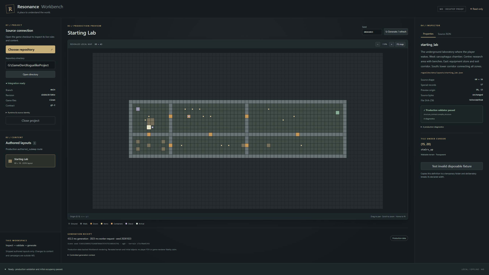

# W0 — Desktop architecture and game integration

Delivered 25 October 2026 (America/Edmonton). **W0 only.**
Implementation: `23a1501ddb174c7d4a9a6c11954cccb352eede9b`, followed by the
verified cleanup correction `d26b63b7205ed2eb2b11ac7f6f37c99ca9fcfb60`.

Resonance Workbench launches as a real Tauri 2/React/TypeScript Windows desktop
window, selects the live repository, shows revision/integration state, validates
the shipped starting laboratory and displays its generated 80 × 43 local map in
PixiJS. Release and portable launches work offline with the real bundled Python
runtime. No game-side adapter or gameplay change was necessary.

## Source preflight and authoritative route

The inspected production checkout was `main` at
`7745f72ea5446af22d3f340c30043d3752ef0f54`, not the historical G16 baseline.
G17 implementation `796b8fe` and delivery `7745f72` were present. Root
`AGENTS.md`, root README, `requirements-baseline.txt`, the current authoring guide,
G17 delivery, compiler/catalog, authoring CLI, local generator, scene builder,
preview consumer and relevant structure/G17 fixtures were inspected. No nested
AGENTS file applied. The only pre-existing work was the untracked owner plan;
it remains untracked and byte-identical. The brief's approval of the plan's
direction governs W0 despite the proposal's older status wording.

The chosen shipped asset is
`roguelike/data/layouts/starting_lab.json`: ID `starting_lab`, 60 × 16 source
grid, 17 special records. `DataLoader` constructs the actual structure catalog;
the W0 list selects only immediate `authored_submap` layouts from it. There is
one such shipped definition at this HEAD. Dependencies include production
terrain, text/item definitions, `crate`, and the `storage_tools` loot pool.

Validation calls `generation.structure_contract.read_document` and
`compile_structure` with the actual data loader and `g2-2` contract. The valid
asset passes with four real warnings: two deferred special behaviors and two
inactive fields. Warnings remain visible under production diagnostics; they are
not converted into false runtime promises. The negative control writes only a
temporary JSON copy with width 61 and feeds it through those same APIs. The
real `DIMENSION` error identifies `width`, asset, file and correction.
[Invalid-fixture desktop evidence](w0-invalid-fixture.png).

Preview calls `generation.structure_preview.preview`, which calls
`engine.scene_generation.create_submap`,
`generation.local_gen.generate_submap` / `_generate_submap_from_layout`, and
production population/factories. The returned `LocalMap` supplies every terrain
ID; Python checks all 3,440 coordinates before transport. No generator,
validator or factory is copied into Rust or TypeScript.

G17's direct authored creature contract is delivered, including initial
occupancy and atomic scene construction. Its example remains under docs, outside
native selection. W0 neither installs that example nor enables creature editing.

## Controlled scene and rendering

World/global Python/NumPy seed: **20261023**. Native numeric thread pools: **1**.
Scene seed (transported as an exact decimal string):
`53693250991751460784647974755340343741`.
Scene address: `[0, 0, "preview-submap"]`; production laboratory type,
centering/translation only, no rotation. Source origin `(10,13)`, actual arrival
`(15,20)` = `stairs_up`; `(67,16)` = `door_open`; `(79,42)` = `wall`.
The factory-created crate is at `(26,17)`; this controlled seed supplies one
`crude_blade`. Fourteen cells contain floor objects. Initial occupancy passes.

Terrain SHA-256:
`c73cf0a453fd175538020adeaa6e588e609ba90852bd723479c5cd2771bd6b3d`.
Candidate semantic SHA-256:
`0bde7868f7545835c34efe5ee6bc463dc9619d58d826f099a97cffc6ed95f380`.
Game Python source SHA-256:
`79debddbf4860b264d8f7cb3df1fff6adf78c82021377ee07503ab384fda38d3`.
Catalog/data SHA-256:
`5bd33d875fd924bf552cf0879f0ee6b66e821a03afa59508d5e86fb00352f8db`.

Repeated controlled previews agree on terrain and populated objects. This is an
authored production scene, not a BSP sample, natural selection/frequency claim,
simulation or guarantee of global gameplay RNG replay.

The Pixi view provides zoom, drag/keyboard pan, fitting and exact cell inspection.
Upper-left origin, rectangular clipping, corners and zoom anchoring have TS
tests; actual WebView pointer input at arrival returns `(15,20)` / `stairs_up`.
The static scene redraws on interaction, avoiding a permanent render loop.

An additional cheap headless reference uses the existing
`rendering.renderer.Renderer.render` and real sprite registry: dummy SDL,
uniform lighting, fully revealed geometry, no player, Engine or game loop.
Its terrain hash is identical; the room, doors, stair and object locations agree
with the Workbench image. Colors, sprites, markers and lighting presentation
deliberately differ. Initial ASCII setup needed the production sprite registry
for floor objects; the final reference uses the normal sprite route. No game
renderer fix was introduced. [Production reference](production-revealed.png).

## Bridge, lifecycle and preservation

Rust owns root canonicalization, native picker and approved child launch. The
frontend has no filesystem, shell, HTTP or arbitrary-launch plugin permission.
Only identify/describe/inspect/preview are accepted, with protocol version,
correlation ID, strict response envelope, bounded output and structured errors.
One short-lived worker per request provides fresh imports/data and simple
cancellation. Diagnostics use stderr; the generation timeout is 90 seconds.
Future expansion can add an explicit operation after contract review; no generic
capability registry or plugin system was implemented.

Host and worker reject traversal and unrelated roots; the worker rejects source
links escaping the chosen root. Imports use the selected current source, with
bytecode writes disabled. A Python audit guard prevents incidental writes
outside the disposable directory and personal-save reads. Trusted source is
required: this is not an OS sandbox for hostile Python/native code. There is no
arbitrary-code request in the bridge.

The parent owns the temporary root and synchronously reaps its child before
removing it on cancellation, project replacement or window close. A late audit
caught an empty root left by a transient Windows lock. Cleanup now retries for
up to one second and reports a structured failure if still blocked; Git source
checks use the repository as cwd and disable optional index locks/fsmonitor.
A real locked-file Rust test covers the retry. All three lifecycle cases were
exercised with a deliberately stalled test worker; desktop runs also assert no
temporary worker roots remain after close. No lingering Workbench temporary
roots or workers remained after final verification.

Byte-exact inspection/refresh/close/reopen tests compare the real source bytes,
SHA-256, size and last-write/creation metadata. The broader pre-edit manifest
checks **7,972 pre-existing files and seven save files**, including the untracked
plan, with zero changes and an unchanged save file set. Save files are hashed by
the independent preservation audit; the Workbench worker never opens them as
campaigns. Filesystem-managed access times are not used as a write detector.
No game content, source, historical evidence, campaigns, editor or wiki changed.

## Windows packaging and measured behavior

Verified environment: Windows x64, CPython 3.11.0, pygame 2.6.1, tcod 19.3.0,
NumPy 2.4.6, Node 24.15.0/npm 11.12.1, Rust 1.95.0/MSVC and VS 2022 C++ tools.
Tauri Rust 2.12.5 / CLI/API 2.12.4, React 19.3.1, Vite 7.3.1, TypeScript 5.9.3
and PixiJS 8.22.0 are pinned with dependency lockfiles.

The successful packaging path is a **directory sidecar runtime**, copied with
Tauri bundle resources: official hash-verified CPython 3.11.0 embeddable x64
distribution, exact hash-pinned wheels, and `bridge.py`. Rust starts that fixed
interpreter/script. It does not package game source, use a dummy worker or rely
on PyInstaller's discovery of dynamically imported game modules. Source remains
live and authoritative. A single-file Python sidecar was not pursued because the
directory form already proves the actual dependency set without hidden setup.

| Artifact / observation | Measured result |
|---|---|
| Release executable | 9,138,176 bytes (8.71 MiB) |
| CPython + dependency directory | 90,947,960 bytes (86.73 MiB) |
| NSIS installer | 27,364,957 bytes (26.10 MiB) |
| Final release launch to ready shell | 461 ms |
| Open repository through rendered preview | 3,937 ms |
| Warm preview sample | 147.80 ms generation, 733 ms whole worker request |
| Three standalone worker samples | 141–144 ms generation; 0.69–0.74 s including process/import/source checks |
| Worker memory after thread cap | about 52 MiB peak working set, 39–40 MiB sampled private memory |
| Host + WebView representative workflow | 466 MiB summed working sets, 362 MiB private memory; shared pages can be double-counted |
| 2560 × 1440 interactive pan test | 119 frame intervals; median 16.7 ms, p95 17.0 ms, maximum 17.2 ms |
| UI while worker starts | 19 animation frames in the first 300 ms; cancel stays usable |

These are samples on this machine, including WebView2/CDP instrumentation and
normal OS/cache variation. They are not universal startup bounds or a 60-FPS
guarantee. The initial default numeric thread pool had roughly 780 MiB private
commit; capping its unused parallelism reduced this without changing the terrain
hash or populated-object repeatability.

Both release and copied portable directories launched with WebView networking
disabled. The portable clean-environment run additionally removed Python, Node,
Rust and Git from the app's PATH and removed `RESONANCE_PYTHON`: the bundled
worker still validated/generated successfully. Git labels became unavailable,
while actual source/catalog hashes remained available.

WebView2 **155.0.4283.62** was present and used. W0 does not include a fixed
WebView2 distribution or download it at install time. It is an explicit Windows
prerequisite. NSIS was built successfully; the tested executable/resources were
launched directly without installing into the owner's application registry.
Signing, installer UX, updater and first installation on a machine lacking
WebView2 remain outside the spike. macOS/Linux are unverified.

One release-only failure was found and fixed: default Pixi shader generation
requires eval. The official `pixi.js/unsafe-eval` static implementation removes
that need; the final release retains strict CSP without `unsafe-eval`.

## Verification and stopping point

Exact commands and setup are in [README](../README.md). Compact results and
source/binary hashes are in [verification.json](verification.json); larger logs,
raw previews, disposable profiles and packages remain ignored in `.artifacts/`
and `src-tauri/target/`.

| Check | Result |
|---|---|
| TypeScript build/typecheck; Vite release assets | Pass |
| TS rectangular coordinates / zoom anchoring | 2/2 pass |
| Rust envelope/root/traversal/cancellation/locked cleanup tests | 5/5 pass |
| Rust clippy with warnings denied | Pass |
| Development Python process-level bridge tests | 9/9 pass |
| Bundled Python suite | 8 pass; missing-dependency control instead uses the empty runtime / development interpreter |
| Actual development and release desktop workflows | Pass, with screenshots and native HWND evidence |
| Offline portable launch without system developer tools | Pass |
| Missing worker/dependency, version mismatch, malformed stdout, process exit | All show actionable desktop errors |
| Stalled child cancel / project replacement / native window close | All reap worker and clean up |
| Invalid temporary definition | Real `DIMENSION` diagnostic; source unchanged |
| Headless production-renderer comparison | Pass, identical terrain grid |
| Pre-existing source, owner plan and saves | Byte/metadata preservation pass |
| npm production dependency audit | Zero reported vulnerabilities at verification |

No game-side file was touched, so the gameplay release campaign was not
commissioned or rerun. Existing production policies were not changed or relaxed.
The unchanged game APIs are exercised by the actual worker and reference sample.

Checkpoints: `checkpoint/workbench-w0-start-20261025-a`,
`checkpoint/workbench-w0-inputs-20261025-a`,
`checkpoint/workbench-w0-inputs-20261025-b`,
`checkpoint/workbench-w0-verified-20261025-a`.
All scoped W0 commits are published to the existing repository's `main`; the
final response records the pushed SHA and remote readback. The owner's untracked
plan is preserved separately. No compiled package/cache is committed.

**No W0 blocker remains.** The next logical W1 dependency is an explicit
authoring/write contract and conflict-safe save design, alongside a deliberate
capability extension beyond this one read-only route. It is not implemented here.
H1/gameplay work and wiki upkeep remain separate commissions.

Technical references consulted: [Tauri architecture](https://v2.tauri.app/concept/architecture/),
[Windows prerequisites](https://v2.tauri.app/start/prerequisites/),
[sidecars](https://v2.tauri.app/develop/sidecar/),
[capabilities](https://v2.tauri.app/security/capabilities/),
[Vite integration](https://v2.tauri.app/start/frontend/vite/),
[Windows packaging](https://v2.tauri.app/distribute/windows-installer/), and
[Pixi performance](https://pixijs.com/8.x/guides/concepts/performance-tips).
