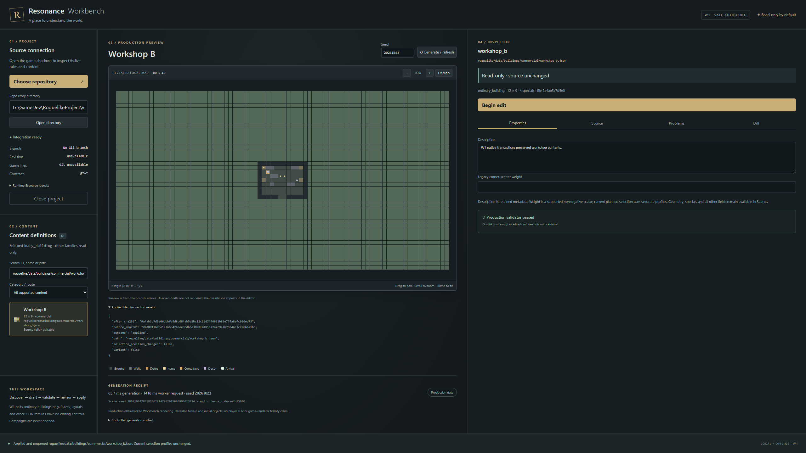
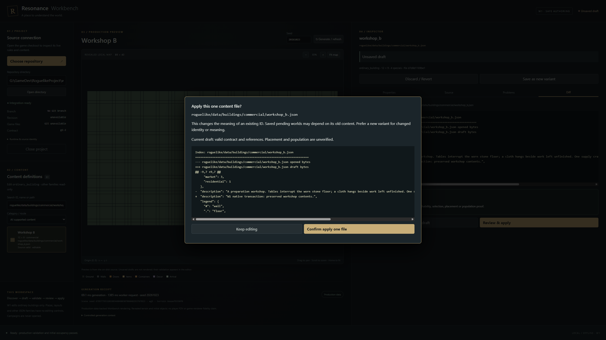
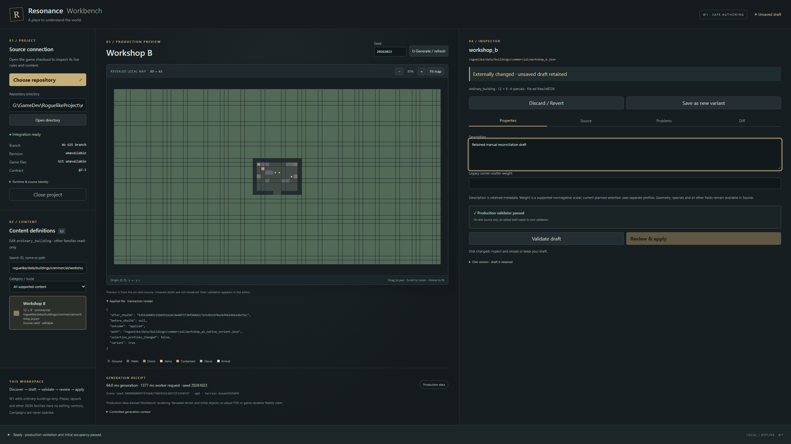

# W1 — Safe discovery and first authoring transaction

Delivered 26 October 2026 (America/Edmonton). **W1 only.**
Implementation: `84cd66ecf3152029b4bd11a8b9c259cce1b605fa` on production `main`.

Workbench now discovers all 58 shipped ordinary buildings, searches ID/name/path,
filters by category, and opens a complete byte-preserved source document. An
explicit edit creates one shared raw/property draft. The author can inspect its
diff, validate it with the current game, confirm a single-file apply or create a
unique variant, and reopen the actual disk result. The Windows host refuses
invalid drafts, stale sources, forged identities and disallowed destinations.
W0's real 80 × 43 starting-laboratory preview remains available read-only.

## Source reconciliation and W0 acceptance

Preflight `HEAD`, local `origin/main` and remote readback all identified
`36cf60e35245e1e1487bb7f1b3937b64b20271a6`, branch `main`. The only owner change
was the untracked `RESONANCE_WORKBENCH_PLAN_PROPOSED_2026-10-25.md`; it remains
untracked and unchanged. No gameplay commit intervened after W0. W0 comprises
implementation `23a1501`, cleanup correction `d26b63b`, and delivery `36cf60e`.
The latest gameplay commits are G17 `796b8fe` and its delivery `7745f72`.

Read: root AGENTS (no nested guidance applies), Workbench README, actual W0 brief
from Downloads, W0 delivery/evidence, approved Workbench plan, supplied W1 brief,
current workflow/compass references, current `STRUCTURE_AUTHORING.md`, W0 host,
worker, UI and tests. Production APIs inspected: `DataLoader`, `StructureCatalog`,
`read_document`, `compile_structure`, `structure_preview.preview`, its ordinary
building stamper/population route and authored `create_submap`/local generator
route. `tools/structure_authoring.py` and its documented consumer routes supplied
the authoring context. No game API or gameplay semantic change was needed.

Before substantial edits, reran W0 web build/typecheck, both TS coordinate tests,
all five Rust tests, all nine development-Python process tests, the headless
production-renderer reference, and the packaged native Windows workflow offline.
Those passed, including map coordinates, deliberate invalid fixture, byte-exact
reopen, cancellation, invalid project and worker-root cleanup. The independent
reference retained terrain SHA
`c73cf0a453fd175538020adeaa6e588e609ba90852bd723479c5cd2771bd6b3d`.

W0 had a functioning native bridge and real game validation; no foundation blocker
or fake preview was found. W0's historical development-window, portable clean-PATH
and original NSIS-creation claims were read from its report; they were not all
independently rerun in preflight. W1 rebuilt the Windows executable and NSIS
installer and reran native release/fault workflows. Installer UX, signing and
installation on a clean machine remain unverified, as in W0.

One provenance issue surfaced with W1's nested disposable fixture: `git -C` could
find a parent repository and incorrectly label the fixture as that checkout.
Source identity now requires Git's top-level directory to equal the selected
root; the fixture correctly reports Git unavailable. W0's read-only schema did
not handle authoring drafts or an invalid catalog; W1 adds bounded discovery and
source inspection in that state, while retaining hard validation before writes.

## Chosen content and boundaries

`ordinary_building` is the single editable family. It supplies 58 actual shipped
definitions across seven current folder categories. This is more useful for W1
than making the sole shipped authored layout editable. The primary sample is
`roguelike/data/buildings/commercial/workshop_b.json` (12 × 9, four specials);
`commercial/apothecary_b.json` supplies the second no-op/deep-fidelity sample.
Both retain nested decor, specials, unknown metadata and text bindings. Two
plazas are visible but unsupported/read-only; `starting_lab` retains inspection
and generation. Other JSON families have no editing controls.

Typed description and optional nonnegative legacy scatter weight use exact
scalar text spans. A native textarea is the one raw editor; `jsonc-parser` only
locates spans and diagnoses strict syntax, and `diff` produces a unified source
diff. Neither supplies gameplay rules. Duplicate keys, comments, trailing commas,
invalid strings and nonfinite values are rejected; Python remains authoritative.
No partial-object serialization occurs. Tests prove unchanged spans, CRLF/BOM,
unknown fields, nested arrays and specials survive supported scalar edits.

The versioned bridge is protocol 2 / worker 0.2.0 / game contract `g2-2`.
`validate_draft` writes exact UTF-8 bytes only into isolated temporary data and
runs the real `DataLoader`, `read_document` and `compile_structure`. It checks
the complete current catalog, references and duplicate IDs, then verifies source
and data identities again. Diagnostics distinguish syntax from contract/reference
failures. Warnings stay visible. Unsaved drafts have **no** reachability,
placement, population or natural-selection certification. The separate map is
explicitly labeled as the saved source's real direct-consumer preview.

New variants use a unique safe ID and a derived filename in the original existing
category. No current town/roadside selection profile is edited. Source research
also found that legacy flat-pool generation discovers definitions by folder;
the UI and README disclose this rather than promising all historical generation
policies ignore newly added files. No gameplay selection test is claimed here.

## Publication and failure behavior

The renderer has no filesystem/shell plugin. Only local event-listening permission
was added for native close protection. Python retains its read-only game boundary
and never opens campaigns. Rust alone publishes content through opaque discovered
document/review identities; apply accepts stored reviewed bytes, not a renderer
path or a renderer-supplied validation verdict. Opening is read-only by default.

Before apply, the host rechecks the original bytes, allowed family/path, resolved
parents, reparse points, destination and ID. Windows handles pin source/data
directories and existing dependency files during fresh validation. Input hashes
and membership are rechecked. The source read lock is released just for
publication; the host compares bytes immediately before replacement and checks
the actual displaced backup afterward. A simulated edit in that gap is restored
from its actual backup, with neither external bytes nor the in-memory draft lost.

The sibling stage is flushed and its writer closed before `ReplaceFileW`.
Windows creation-time preservation was tested. Supported ACL/metadata retention
uses that Windows API; universal filesystem metadata parity is not claimed.
Injected create/write/rename/post-replace failures, a real sharing violation and
a read-only target leave the original valid source intact. Normal failed paths
remove temporary files. No-clobber persistence prevents variant overwrites.
Successful results contain exact target, old/new hashes and outcome, then reopen
the index/editor/preview from disk. There are no in-app Git mutations.

If an exceptional rollback or cleanup cannot finish, the error names retained
recovery files and the disk status lists `.w1-*` remnants; ambiguous crash
remnants are never silently applied. If a different writer changes the new file
during verification, that version and the prior backup are retained for manual
reconciliation. This is not a proof of perfect power-loss atomicity or resilience
against every filesystem/hostile concurrent writer. Forced process termination
loses the in-memory draft; an actual kill/restart test confirms source remains
valid and reopens unchanged.

Meaningful development failures were reproduced and fixed: an open staging writer
caused Windows sharing error 32; keeping the original source handle through
rollback also blocked Windows replacement. Staging now closes before replacement,
and the source lock covers validation then releases for the compare/backup-checked
publication. The fault tests require their injected stage to be reached, so an
earlier unrelated error cannot masquerade as a passing rollback test.

## Acceptance and evidence

Commands are in [README](../README.md). Exact source/binary identities, compact
native receipts and measured values are in [w1-verification.json](w1-verification.json).
Larger test-owned logs, runtime-input replicas, captures and build outputs remain
ignored under `.artifacts/` and `src-tauri/target/`. Replicas contain only required
Python/data inputs, no Git repository or campaigns; no development checkout,
branch or worktree was created.

| Check | Actual result |
|---|---|
| TypeScript/Vite production build | Pass |
| TS tests (original coordinates plus draft fidelity/diff/staleness) | 7/7 pass |
| Rust host tests (original five plus publication security/recovery) | 10/10 pass |
| Rust clippy with warnings denied | Pass |
| W0 Python process suite | 9/9 pass |
| W1 Python process suite | 3/3 pass, with multiple real invalid/reference/identity controls |
| All supported candidate discovery and two shipped no-op sources | Pass |
| Strict JSON, broken terrain, dimensions, coordinates, negative weight and ordinary-building creature rejection | Pass |
| Invalid source remains inspectable; valid repair draft validated without live overwrite | Pass |
| Native edit → diff → validate → confirm → apply → reopen/revalidate | Pass on disposable workshop |
| Native unique variant, unchanged current selection-profile bytes | Pass |
| Native changed dependency after review | Fresh apply validation refuses it; source preserved |
| Native external edit conflict and visible reload recovery | Pass; external version retained |
| Forged token/review, traversal, saves/code, absolute paths, unsafe variant and junction redirect | Rejected at the host boundary |
| Real stale asynchronous response | Does not authorize the newer draft |
| Native close/refresh protection; forced interruption and fresh restart | Pass |
| Missing worker, mismatched protocol, malformed output, worker exit, stalled cancel/replacement/close | Actionable failures and cleanup pass |
| Final Windows release executable and NSIS installer | Built; release launched offline using bundled Python |
| npm production and full dependency audit | Zero reported vulnerabilities at verification |
| Pre-existing game/source/evidence, owner plan and seven saves | 7,979 files unchanged in bytes/size/mtime; save set unchanged |

Windows environment: build 26200 x64, WebView2 155.0.4283.62, CPython 3.11.0,
pygame 2.6.1 / tcod 19.3.0 / NumPy 2.4.6, Node 24.15.0, npm 11.12.1,
Rust 1.95.0/MSVC. Tauri 2.12.5 / API/CLI 2.12.4 and React 19.3.1 remain;
Vite 7.3.7, Vitest 4.1.12 and the compatible esbuild patch remove reported dev-tool
advisories. New editing utilities are jsonc-parser 3.3.1 and diff 8.0.4, pinned in
the lockfile. No startup prerequisite was added.

| Final packaged observation | Measured result |
|---|---|
| Executable / NSIS installer | 9,561,088 / 27,459,087 bytes |
| Launch to shell | 943 ms |
| Open disposable project through rendered preview | 9,721 ms |
| Starting-lab generation / complete request | 306.64 / 1431 ms |
| 119 pan-frame samples | median 33.3, p95 33.4, max 33.5 ms |
| Frames during first 300 ms of worker activity | 10 |

Native timings and 2560 × 1440 frame samples are observations from this machine,
including WebView throttling/instrumentation and cache variation; the receipt
records them without a universal 60-FPS promise. Validation remains asynchronous,
and typing, stale-response suppression and cancellation were exercised while a
real Python worker was active. No browser-only Vite result is counted as native
desktop proof. No owner desktop input or routine owner verification was used.

Checkpoints: `checkpoint/workbench-w1-start-20261026-a` and
`checkpoint/workbench-w1-verified-20261026-a`. The final publication SHA is recorded
in the final response and remote readback. The brief
authorizes scoped commits and a normal push to existing `origin/main`; no force
push, reset, branch, worktree, game/content modification or wiki upkeep occurs.
No game-side adapter was required; unchanged game contracts are exercised through
the real worker and W0 reference, without rerunning unrelated gameplay campaigns.

**W1 stops here.** Visual painting, other-family editors, schema/plugin systems,
persistent draft recovery, cloud services and W2–W6 remain separate work.

Implementation references: [Tauri capabilities](https://v2.tauri.app/security/capabilities/),
[Microsoft JSON text-edit APIs](https://github.com/microsoft/node-jsonc-parser/blob/main/README.md),
[ReplaceFileW](https://learn.microsoft.com/en-us/windows/win32/api/winbase/nf-winbase-replacefilew),
and [CreateFileW sharing](https://learn.microsoft.com/en-us/windows/win32/api/fileapi/nf-fileapi-createfilew).
