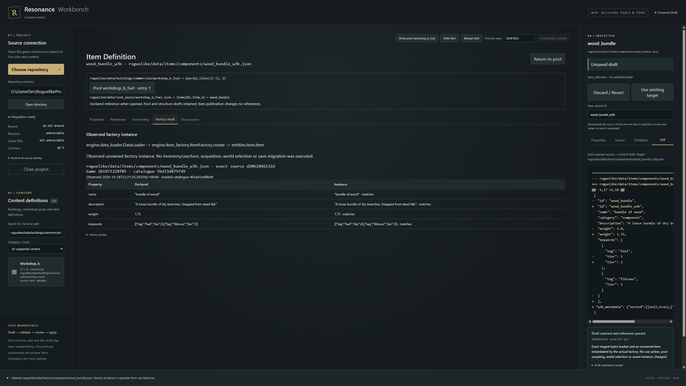

# W3B — Component item definitions and use tracing

26 October 2026, America/Edmonton. Existing production `main`; W3B only.

Workbench now follows a real contextual pool entry to its item, edits one narrow
component family through the existing shared source draft and host transaction,
publishes a new item and deliberately references it from a new pool variant.
The native demonstration observed both the real factory result and seeded
container population. Advanced items remain read-only. No existing gameplay
module, shipped definition, selection profile, campaign or wiki file changed.

## Baseline and W3A reconciliation

Before edits, `HEAD`, local `origin/main` and `git ls-remote origin refs/heads/main`
all returned **4af2f9d552e9be44558f74b099749f3e78b1a919**. Actual W3A implementation
is `0b492dcbd778bd65b88932908f5c9f9bfd85e8fb`; its delivery is `4af2f9d`.
The latest gameplay implementation/delivery remains G17 `796b8fe` / `7745f72`;
no gameplay commits intervened between W3A and this baseline. The only existing
uncommitted file was the owner's proposed Workbench plan, retained unchanged
and untracked. Start checkpoint: `checkpoint/workbench-w3b-start-20261026-a`.

Read root AGENTS (no nested instruction files), the commissioned brief and W3A
review, approved Workbench plan and relevant compass/decisions/workflow/proposal
references, W0–W3A delivery records, current README and structure-authoring
contracts. Inspected the actual W3A receipt, native screenshots and examples;
the companion review's unverified historical assumptions were not treated as
current facts. Code coverage included App/Authoring/draft/layout/pool/protocol,
Rust discovery/tokens/locking/atomic publication, worker isolation/cancellation,
native runners and focused tests.

Before source changes, independently reran the web build, **18 TypeScript**,
**13 Rust** and **21 Python** tests (Python: 111.160 s), plus the packaged native
W0/W3A journey (59.571 s). All passed. That journey selected an actual container,
opened its pool/item snapshot, retained the structure draft, edited and validated
the exact pool, saved two deliberate variants, reopened them and checked conflicts.
Its app-local capture was visually inspected. Known decorative strings were
absent from rendered chrome. No systemic W3A boundary blocker was found.

One bounded shared-navigation hardening adds epoch guards to pool/item lookups
and post-save refreshes. Refreshed reference context is attached only when the
opened document path and hash still match. The native regression closes/reopens
a project during item lookup and proves a late response cannot restore the item.
The reopened item/pool hash must also match the publication receipt before the UI
reports success; failed reopening retains the draft's unsaved protection.
No parallel draft mechanism or file writer was introduced.

## Current game contract and implementation

App/worker **0.5.0**, protocol **5**, unchanged structure contract **g2-2**;
read-only item capability **component-1**. No dependency version or frontend
permission changed. All changes are in `workbench/`, except the small new
`roguelike/engine/item_authoring.py` adapter. Gameplay does not import it.

Inspected current `DataLoader._load_dir`, `ItemFactory.create`, `Item`,
`ItemSystem.use` and actual handlers, `Inventory`, inventory display grouping,
crafting predicates/allocation, `item_transfers`, `save_components`, `TileRegistry`,
keyword/quality catalogues, recipes and representative component, consumable,
light and weapon definitions. Item discovery is recursive and supports individual
objects or arrays. The game loader still silently skips bad files and overwrites
duplicate IDs; authoring independently detects ambiguous sources and blocks them,
showing the paths. Case collisions are also blocked for authoring.

The new adapter uses the current factory, `ITEM_STATE`/`validate_fields` and
crafting's `_item_has_tag`/`_item_has_all_tags`. It adds the narrow capability and
reference checks missing from the permissive loader; it does not change runtime
loading, use, save or ownership semantics. It never mutates a definition or
constructs an inventory, Engine or campaign.

| Writable field | Verified meaning / limit |
| --- | --- |
| `name`, `description` | Literal strings carried into the instance; authored wording is preserved. |
| `weight` | Finite nonnegative number; inventory reports kg per separate instance. |
| `stackable` | Boolean inventory display grouping by ID. Separate ownership and weight remain. No stack-size mechanic is invented. |
| `keywords[n].tag` | Current `keywords.json` ID, copied by the factory and consumed by crafting predicates. |
| `keywords[n].tier` | Nonnegative integer from the persisted-instance contract. The editor caps it at `2^53−1` for exact transport. |

Only a unique single-object inert `category: component` definition under
`items/components/` is writable, including safe nested directories. The current
four are wood bundle, flint shard, clay lump and clay pot. Active use, equipment,
light, effects, nonempty qualities/text binding and other known advanced fields
exclude a definition from this capability. Category and tile have no typed
controls. Unknown metadata is retained without a mechanical-support promise.
Weapons, tools, satchels, status-bearing consumables, arrays and unknown categories
remain readable as full source, with no host publication entitlement.

`ItemEditor` uses the same Authoring text/revision/history/diff/verdict as W1/W3A.
Opening and returning are byte-exact no-ops. Scalar edits replace current spans;
keyword insertion/removal also preserves unrelated spans, nested metadata and
remaining order. Invalid JSON remains in Source and freezes typed controls.
Raw/identity edits clear only that document's visual history. One structure,
pool and item capability/draft can coexist; applying one revokes every review
while retaining the other drafts. Publication is still one reviewed file.

Rust checks discovered document entitlement, safe relative names, canonical
containment, reparse points/junctions, source hashes, case collisions, current
dependencies and exact draft hash/verdict before the existing atomic transaction.
Advanced item tokens cannot become writable by changing raw category. Variants
stay next to the source, require a new ID and use no-clobber persistence. Original
and persisted bytes are rechecked. Worker/rendering code gains no live write API.

## Source and use evidence

**References** derives saved contextual pool rows from actual files, retaining
entry indices and array pointers. Returning from an item focuses the original
pool entry. Container context remains visible separately from the saved/draft
pool and item paths. Declared tile/text/tag IDs are resolved against current
catalogues; tile IDs use the real `TileRegistry` wrapper format. Recipe outputs
are declared references; ingredient/tool/conjunction matches are labeled
**Potential tag match**, without quantity, inventory, knowledge or ambient proof.

**Use binding** checks the actual dynamic dispatch used by `ItemSystem.use`,
reporting Handler found / Unknown handler / Not applicable plus method/source
location. It explicitly does not run ownership, equipment-repair, turn or handler
preconditions. `on_use_effects` in the shipped resonant tincture is not consumed
by its actual `drink` path or the factory. `consumed_on_use` controls automatic
crafting-material eligibility; it is not a universal use-consumption switch.
`gather_from` and a hypothetical `stack_size` have no current item consumer.
Quality data is loaded/copied, while the current crafting allocation uses tags.
Advanced weapon/equipment fields can be consumed by later systems reading their
definitions directly; absence from the basic instance is not called inert combat.

**Factory result** is an independently observed unowned instance, only after
calling the real factory. It records UTC time, exact definition hash, source/game
identity, loaded-catalogue hash and declared-vs-instance comparisons. Dirty drafts
hide old factory output until validation. References/use detail that still belongs
to the opened snapshot is labeled as such. No TypeScript mechanic calculation or
ordinary-play claim is used.

## Native vertical proof

The exact native outputs are retained outside live content as
[item variant](examples/wood_bundle_w3b.json) and
[pool variant](examples/workshop_b_fuel_w3b.json). The runtime fixture is an ignored
disposable data/Python root without Git or campaigns, not a development checkout.

1. Selected `commercial/workshop_b.json`, container `special_tiles[3]`, crate
   at source **(2,2)**, then its actual `workshop_b_fuel` pool and `wood_bundle`.
   An unsaved structure draft and pool weight edit remained independently parked.
2. Viewed real use/references, returned without rewriting source, then explicitly
   edited item weight **1.0 → 1.75 kg** and fuel keyword tier **1 → 2**. Nested
   test metadata and authored text survived. Undo/redo, invalid raw freeze,
   inter-document switching and late-validation rejection were exercised.
3. Validated exact bytes, reviewed diff, confirmed **wood_bundle_w3b**, reopened
   it and observed its factory ID, weight and keywords. The original was unchanged.
4. Returned to the retained pool, deliberately selected the new item and published
   **workshop_b_fuel_w3b**. Reopening the item showed the actual reverse reference.
   Both files were reopened again from a fresh native project session.
5. For additional observation only, changed the retained structure draft's second
   container-pool reference to the new pool and ran the existing production preview.
   Seed **20261023**, scene seed **6637439373377807600445427017063809115**, origin
   **(34,17)**, container **(36,19)**. The actual stamper/populator/roller/factory
   created `wood_bundle_w3b` at **1.75 kg**, with fuel tier **2**. The structure
   draft was discarded; no shipped structure or selection membership changed.

The receipt records exact hashes and full observed objects. Fixture Git commit
is correctly null; the checked-in source hashes and preflight/result revisions
bind the run. No ordinary interactive item use or natural-world acquisition was
tested or claimed. Failed pool publication can leave a valid unreferenced item;
there is no cross-file transaction or silent cleanup.

## Verification and limits

Commands use `workbench/` unless noted. Full logs/fixtures remain ignored under
`.artifacts/`; the concise [receipt](w3b-verification.json) records source/binary,
example and screenshot hashes, timings and successful native checks.

| Command / control | Result |
| --- | --- |
| `npm.cmd test` | 21 passed; no-op/spans, malformed drafts, independent histories, stale revisions and prior pool/canvas checks. |
| `npm.cmd run build:web` / bundled typecheck | TypeScript and Vite passed. |
| `cargo test --locked --manifest-path src-tauri/Cargo.toml` | 15 passed; original transaction tests plus item capability/three-document and item rollback/no-clobber cases. |
| `cargo clippy --locked --manifest-path src-tauri/Cargo.toml -- -D warnings` | Passed. |
| `<development-python> -B -m unittest discover -s worker -p 'test_*.py' -v` | 25 passed, 148.234 s; retained W0–W3A plus four substantive item suites. |
| Root, `PYTHONPATH=roguelike;tools/critical_fix_regressions/tests`; `python -B -m unittest test_structure_contract test_structure_access test_crafting -v` | 26 passed, 4.298 s. |
| `npm.cmd run bundle` | Windows release/resources and x64 NSIS built. |
| `npm.cmd run test:items` | Native offline W0 + full W3B authoring/factory/population and safety workflow passed. |
| `npm.cmd run test:pools` | Retained native W0/W3A workflow passed. |
| `npm.cmd run test:visual` | Retained native W0/W2 workflow passed, 38.826 s. |
| `npm.cmd run test:authoring` | Retained W1 workflow passed, 55.754 s; forced interruption and fresh restart also passed. |
| `rustc scripts/fault-worker.rs -o .artifacts/fault-worker.exe`; `WORKBENCH_TEST_MODE=<mode>`; `node scripts/desktop-test.mjs` | Item exit/cancel/timeout, protocol mismatch and malformed-worker controls passed. |

Negatives cover duplicate IDs/paths/case, missing tags/items, invalid tier/weight
(negative, bool, nonnumeric, NaN/infinite), unsupported category/use/advanced fields,
duplicate keys, malformed JSON/BOM, external source conflict, a destination created
after validation, forged/protected paths, internal junctions, stale review and
changed dependencies. Existing injected before/after-stage/replacement and actual
backup rollback tests remain active. Factory/schema checks never authorize a
failed or stale publication.

Measured actual host timeout: **90.098 s**. Item-worker exit/cancel timings are in
the receipt. Each left no verdict/review, source change or worker root. Positive
journeys use the actual bundled Python with WebView network disabled, no runtime
override, and app-local DOM/CDP events. No owner's desktop input is driven.
The receipt contains current catalogue/navigation/input timings; these are bounded
local samples, not universal performance claims. No catalogue virtualization was
needed for the current 79 items (157 total initial content rows).

Environment: Windows x64 10.0.26200, CPython 3.11.0, pygame 2.6.1, tcod 19.3.0,
NumPy 2.4.6, Node 24.15.0/npm 11.12.1, Rust/Cargo 1.95.0/MSVC, Tauri Rust 2.12.5 /
API/CLI 2.12.4, React 19.3.1, TypeScript 5.9.3, Vite 7.3.7, Pixi 8.22.0,
Playwright 1.56.1 and WebView2 155. Development dependency interpreter:
`G:\GameDev\RoguelikeBaseline-20261020\project\.venv\Scripts\python.exe`;
all game imports are from current source or the disclosed disposable runtime data.

During development, tests caught and corrected keyword insertion reformatting
compact unrelated spans and an incorrect direct lookup of the wrapped tile
catalogue. The final route uses exact array spans and actual TileRegistry IDs.
Visual review also caught an encoding error in the new adapter's consumer label;
it was corrected before final evidence. No test failure was waived.

Preservation audit: **7,972 protected existing files and seven save files** retain
their bytes/measured metadata; save-file membership and the owner plan are unchanged.
The only game-side addition is the read-only adapter. No existing production
contract was modified, so targeted caller/contract tests were run rather than an
unrelated full gameplay release campaign; no gate policy was changed.

Reviewed native full/minimum-window captures and rendered chrome. The two named
promotional phrases are absent. No game-authored prose was rewritten. The installer
was built, not installed into the owner's registry; installer UX, signing, updates,
clean-machine WebView2 provisioning and non-Windows targets remain unverified.
Drafts remain memory-only. The existing Python audit boundary is protection
against incidental writes, not an OS sandbox for hostile game source.

Additional native receipts: [component properties](images/w3b/item-properties.png)
and [minimum window](images/w3b/minimum-window.png).

## Publication

Implementation commit:
[`9939e44e405b5b42deca7b94d4ce5f902d1dc4e7`](https://github.com/dgobi/ResonanceRoguelike/commit/9939e44e405b5b42deca7b94d4ce5f902d1dc4e7)
— `feat(workbench): add component item authoring and use tracing`.
Normal `git push origin main` succeeded, and
`git ls-remote origin refs/heads/main` returned that exact SHA. The local verified
checkpoint is `checkpoint/workbench-w3b-verified-20261026-a` at this commit;
the start checkpoint remains at `4af2f9d552e9be44558f74b099749f3e78b1a919`.

The following documentation-only commit carries this report, compact receipt,
two exact native variants and three reviewed captures; its final `main` tip and
readback are supplied in the handoff. No branch, worktree, force-push, reset,
history rewrite or binaries are part of the commits. The owner plan remains
separate, unchanged and untracked.

Method references checked: [Tauri filesystem security](https://v2.tauri.app/plugin/file-system/)
and [Microsoft JSON text/tree APIs](https://github.com/microsoft/node-jsonc-parser/blob/main/README.md).
No filesystem plugin, JSON Schema framework or graph dependency was added.

W3B stops at this item/pool/factory route. Recipe authoring, equipment/effect
editing, save migration, wiki upkeep and later Workbench milestones remain outside
this commission.
