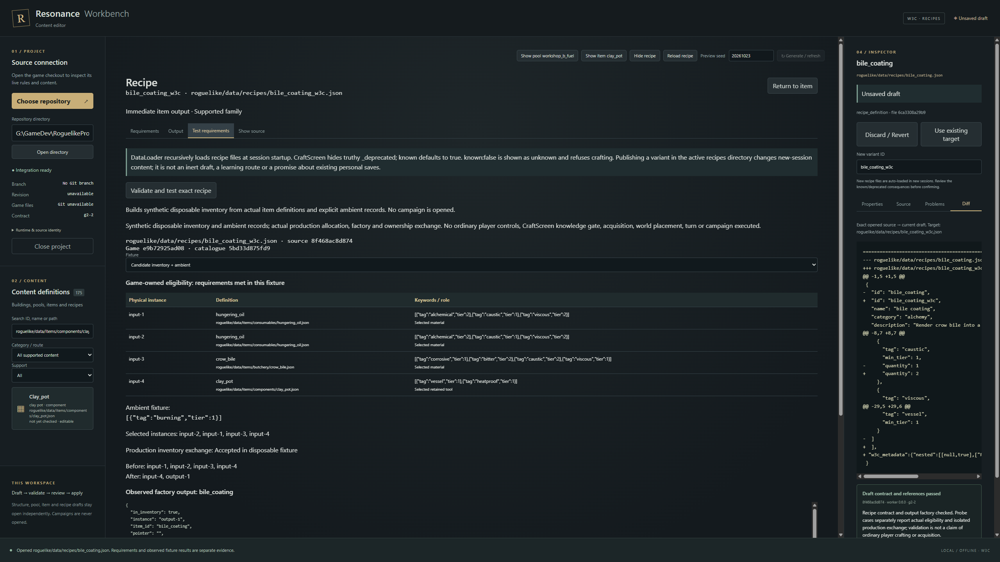
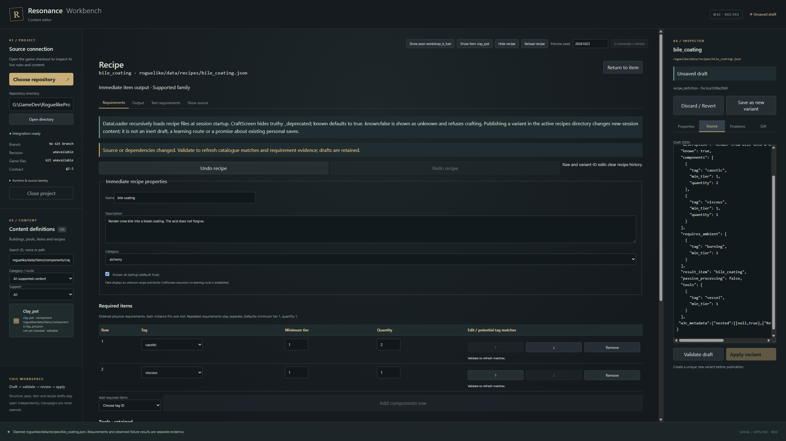
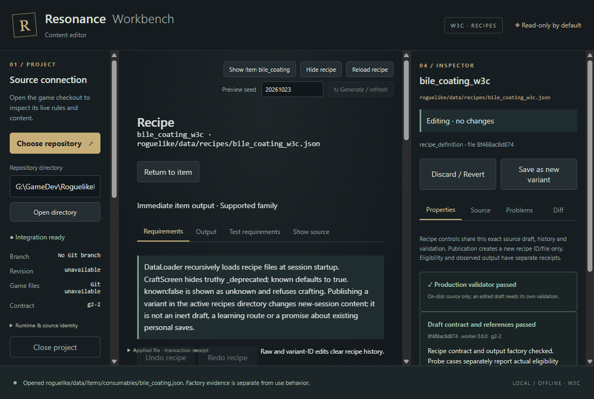

# W3C — Recipe requirements and crafting-chain tracing

26 October 2026, America/Edmonton. Existing production `main`; W3C only.

Workbench can follow an item to declared-output or potential-input recipes,
edit one supported immediate recipe family, validate an exact shared JSON draft,
review and deliberately publish a new recipe variant, reopen its exact bytes,
and test production allocation and inventory exchange in a disposable fixture.
Passive processing, world placement, conjunctions and legacy recipes remain
source-navigable and read-only. No shipped definition, existing gameplay module,
campaign, selection profile or wiki edition changed.

## Baseline and checkpoints

Beginning `HEAD`, local `origin/main` and remote `main` were all
`96f3e4f96be04d84efbba948c32d47cea40537f3`. W3B implementation was
`9939e44e405b5b42deca7b94d4ce5f902d1dc4e7`; its actual delivery tip was that
`96f3e4f` baseline. No subsequent gameplay or Workbench commits intervened.
Latest gameplay implementation/delivery remained G17 `796b8fe` / `7745f72`.
The owner's approved proposed Workbench plan was the only untracked owner file;
it remains unchanged and untracked.

Start checkpoint: `checkpoint/workbench-w3c-start-20261026-a`.
Ending implementation commit: **e76e92a184d7bfd4c6356f2e9ec2e2bb92a683ec**.
Verified checkpoint: `checkpoint/workbench-w3c-verified-20261026-a`.
This subsequent evidence-only commit records that implementation; its final
delivery tip and normal `origin/main` readback are supplied in the owner handoff.
No extra checkout, task branch or worktree was created.

Preflight read root AGENTS (no nested instructions), the commissioned brief,
approved Workbench plan and relevant compass, current decisions, approved gameplay
proposal and workflow. Inspected the W3B delivery, receipt, two exact examples and
native captures; checked the shared source/history, worker handshake and host
publication boundaries against current code. Independently reran 21 TypeScript,
15 Rust and four W3B item-worker tests (56.349 s), plus the packaged offline W3B
native route (55.901 s). All passed. Earlier W3B report counts were treated as
reported historical evidence, not as tests executed here.

## Current source contract

App/worker **0.6.0**, protocol **6**, unchanged structure contract **g2-2** and
item contract **component-1**; new recipe contract **immediate-components-1**.
The only new game-side file is the read-only `engine/recipe_authoring.py` adapter.
Gameplay does not import it. Existing loader, planner, factory, visibility,
ownership, inventory and learning semantics remain unchanged. Frontend permissions
and dependency versions did not expand.

The following current sources establish the boundary:

| Source | Verified consumer behavior |
| --- | --- |
| `roguelike/engine/data_loader.py:101` | Recursive recipe loading accepts objects or arrays, skips invalid files and overwrites duplicate IDs. Authoring independently rejects ID/case/path ambiguity and verifies the exact loaded record. |
| `roguelike/rendering/craft_screen.py:112` and `:254` | Truthy `_deprecated` hides a recipe. `known` defaults true; false displays unknown and refuses the attempt. New files in the active directory affect new sessions. |
| `roguelike/engine/crafting.py:67` and `:97` | Actual material-candidate and tag/tier predicates, ordered requirements, distinct physical instances, retained tools, separate ambient conditions. Default minimum tier and physical quantity are 1. |
| `roguelike/rendering/craft_screen.py:149` | Actual ambient collector derives supported tags from loaded decor/light definitions. `burning` is supported here but is absent from the item keyword registry. |
| `roguelike/engine/item_factory.py:21`, `crafting.py:197`, `item_transfers.py:32` | Real output construction and exact selected-material revalidation, capacity/ownership exchange and cleanup. |

All 18 current recipe definitions are discovered. `bile_coating` is the one current
writable source: ordered caustic/viscous components, a reusable vessel, burning
ambient condition, immediate item output, `known:true`, `passive_processing:false`.
`cook_meat`, `clay_pot` and `musk_pellet` demonstrate passive processing; `campfire`
demonstrates world placement; `coldbell_extract_deprecated` is deprecated.
`briar_binding_oil` has a single-item conjunction; `hungering_oil` contains legacy
`apply_turns`. Both immediate sources remain outside writing entitlement.

Supported fields are literal `name`/`description`, current category, `known`,
ordered `components`, `tools`, `requires_ambient`, and a uniquely resolved
`result_item`. Every published variant requires a new ID/file. Category does not
confer capability; unfamiliar strings retain the runtime's other-category behavior.
Repeated rows stay distinct. Unknown/nested metadata and unedited bytes survive.
Invalid raw JSON is retained and freezes typed operations. Raw/ID edits clear
typed undo history. No-op open/close makes no filesystem write.

Authoring imposes explicit tooling bounds: exact integer tiers 0 through `2^53−1`,
physical quantities 1–32, at most 64 rows per array and 64 physical slots total.
These do not alter game limits. Ambient quantity is runtime-inactive and warned.
Array-of-recipe files, absent/ambiguous identities, passive/placement/conjunction
and listed legacy fields cannot grant publication capability. Raw edits cannot
promote an originally unsupported source or bypass exact-byte revalidation.

## Evidence levels and exact sample

**Produces this item** means the exact declared `result_item` ID. **Potential
ingredient matches** means real factory instances satisfy current tag/tier
predicates; it does not prove quantities, acquisition, knowledge or ambient access.
Recipe output separately reports catalogue resolution. **Test requirements** runs
actual production functions on an explicit synthetic fixture and records its
source/dependency hashes, physical instances, selection, missing requirements,
factory result and before/after inventory. No generic “craftable” verdict is used.

The native sample is [bile_coating_w3c.json](examples/bile_coating_w3c.json), exact
SHA-256 `8f468ac8d874bfdc76c503f1f03e54bcc1af5a49ef0e44edd511173ec0bd3de5`.
It changes the first physical quantity from 1 to 2, retains authored wording and
adds a nested preservation sentinel. It was published only under ignored
`.artifacts/w3c/data-fixture-*`; this tracked example is outside the active catalogue.

The positive candidate preset creates two separate `hungering_oil` instances,
one `crow_bile`, and one `clay_pot`, from unmodified loaded definitions. Selection
prefers non-output definitions, then production tag tier and ID; this is fixture
selection, not an acquisition route. Synthetic ambient is `burning` tier 1.
`plan_craft → ItemFactory.create → commit_craft → item_transfers.exchange` accepted
the fixture: input-1/2/3 were consumed, input-4 (the vessel) remained, and output-1
was a real `bile_coating` instance owned by the disposable inventory. The receipt
records exact source-file and semantic-definition hashes, actual selected order,
output properties, capacity and weight. With no physical inputs, requirements
were missing; with no ambient sources, burning was missing. Neither negative case
attempted output/commit or changed inventory.

This executes real allocation and ownership exchange, but **does not execute
ordinary player controls, CraftScreen's knowledge gate, acquisition, world
placement, turns or a campaign**. The minimal actor and inventory are disposable.
`known:false` can still meet material rules in this fixture while the ordinary
crafting UI refuses it. Synthetic inputs are not evidence of natural availability.
There is no recipe-learning, balance, passive-crafting or world-generation claim.

## Native integration and publication boundary

The packaged Tauri/WebView2 route runs offline through app-local DOM events, with
no desktop takeover. It opens a W3B clay-pot item, follows its potential tool match
to bile coating, edits the shared draft, exercises undo/redo and row order,
retains unknown nested metadata, freezes invalid raw JSON, rejects an unsupported
raw escape, validates, reviews the exact diff, confirms active-load consequences,
publishes a new ID/file and verifies the reopened hash. It returns to independent
building, pool and item drafts without losing source/history, then follows the
output item back to its exact producer recipe. Item and recipe tabs now retain
their selected view and return focus. Late lookup/validation results are rejected.

The host retains four independent document capabilities. Validation does not issue
a recipe publication token without a unique variant. The existing source pin,
canonical containment, no-link checks, reviewed-byte token, atomic no-clobber and
rollback mechanism remains the writer. Recipe reviews additionally bind dependency
identity; a valid external item change still requires revalidation. A three-second
idle disk/dependency check clears stale recipe evidence while retaining the draft.
Apply independently repeats freshness and production validation. Publication revokes
other review tokens, not other drafts. Reopening must match the persisted receipt.

Native negatives cover original-file conflict, valid changed item dependencies,
concurrent destination creation, stale/revoked reviews, unsupported source tokens,
protected/traversal/ADS paths and an internal Windows junction. Rust tests inject
before-stage, after-stage and before-replace failures, verify no residue and an
unchanged original, then exercise successful no-clobber variant publication.
Worker exit, cancellation, real host timeout and protocol/malformed output controls
retain unsaved state and grant no successful verdict or Apply entitlement.

The three captures were visually inspected. The native route checks full/minimum
window root overflow and asserts the owner's rejected promotional strings are
absent from rendered chrome. Labels remain utilitarian; authored descriptions
are preserved verbatim. Long tables use local scrolling. No reskin or graph
framework was introduced.

## Executed validation and limits

All final checks passed. Commands run in `workbench/` unless noted.

| Check | Result | Measured wall time |
| --- | --- | --- |
| `npm.cmd test` | 24 tests | 2.007 s |
| `cargo test --locked --manifest-path src-tauri/Cargo.toml` | 16 tests | 5.075 s |
| `cargo clippy --locked --manifest-path src-tauri/Cargo.toml -- -D warnings` | Passed | 2.518 s |
| Full Python worker suite (cold subprocesses) | 29 tests | 369.981 s |
| Structure/access/crafting game contracts (repository root) | 26 tests | 11.315 s |
| `npm.cmd run bundle` | Passed | 108.089 s |
| `npm.cmd run test:recipes` | Passed | 118.756 s |
| `npm.cmd run test:items` | Passed | 113.050 s |
| `npm.cmd run test:pools` | Passed | 91.586 s |
| `npm.cmd run test:visual` | Passed | 77.071 s |
| `npm.cmd run test:authoring` | Passed | 121.109 s |
| recipe-worker-exit native fault | Passed | 12.617 s |
| recipe-worker-cancel native fault | Passed | 12.326 s |
| recipe-worker-timeout native fault | Passed | 102.059 s |
| protocol-mismatch native fault | Passed | 2.367 s |
| malformed-worker native fault | Passed | 2.402 s |

Exact commands, timing, runtime versions, source hashes, native check lists and
the compact production probe are in [w3c-verification.json](w3c-verification.json).
Times are measured observations on this Windows machine, not performance promises.
The installer was built, not installed. Linux/macOS installation is unverified.

Development failures were resolved before acceptance: the initial recipe handshake
import was placed in the wrong worker function; native return navigation exposed
tab remount/focus timing; and test locators needed to distinguish item versus
inspector Properties and output versus ingredient rows. An earlier broad worker
run returned an envelope without a pool result while work was still changing;
the final full suite was rerun on frozen runtime sources. No failed result was
counted as a pass or waived. Heavy logs, intermediate captures and disposable
fixtures remain ignored under `.artifacts/`.

## Preservation and stopping point

The existing preservation manifest checks **7,972 protected files and seven
personal saves**, their bytes and recorded metadata, save file membership and
the unchanged untracked owner plan. The final comparison passed. Existing
`item_authoring.py` and all other pre-existing gameplay sources remain unchanged;
only the new read-only adapter was added. No active recipe/item variant, wiki
chapter/example/HTML build or gameplay release gate was added. The scoped source
and evidence are committed separately and published normally to `origin/main`.

W3C stops at this one immediate-component recipe route. Passive/world crafting,
learning, balance, equipment/effects, a global relationship graph and W4+ remain
separate work.
